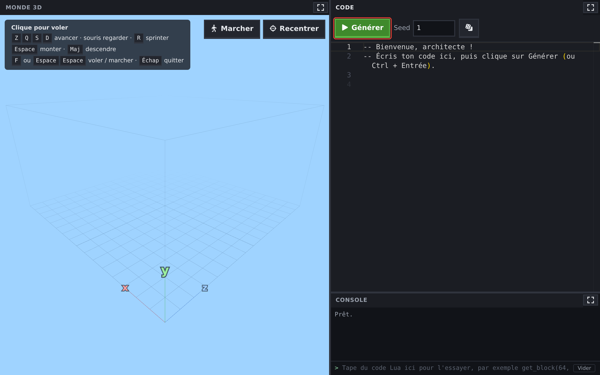

# World Generator

Minecraft ne range pas ses mondes bloc par bloc : il les **calcule**. Quelques formules décident où se dressent les montagnes, où s'arrête la mer, où poussent les arbres et où se cachent les diamants.

Dans cet atelier, c'est toi qui écris ce générateur, en **Lua**. Tu commences par poser un seul bloc. Sept étapes plus tard, ton code dessine des collines, des mers bordées de plages, des sommets enneigés, des forêts, des grottes et des minerais. Et tu peux te promener dedans.

Rien à installer : tout se passe dans ton navigateur, à côté de ces instructions. Compte environ 2 h 55 en tout.

## Comment ça marche

1. Clique sur le bouton **Ouvrir World Generator** : le monde s'ouvre à côté des instructions.
   <!-- ws:cue runtime -->
2. Tu y trouves le monde en 3D, l'éditeur où tu écris ton code, et la **console** sous l'éditeur.
3. Le bouton **▶ Générer** (ou <kbd>Ctrl</kbd> + <kbd>Entrée</kbd>) exécute ton code et construit le monde.
4. Quand tu es prêt à passer à l'étape suivante demande à un encadrant de valider ce que tu as fait.

Chaque étape te donne les outils dont tu as besoin, te prévient des pièges, puis te lance un défi. Les indices sont là si tu bloques.
