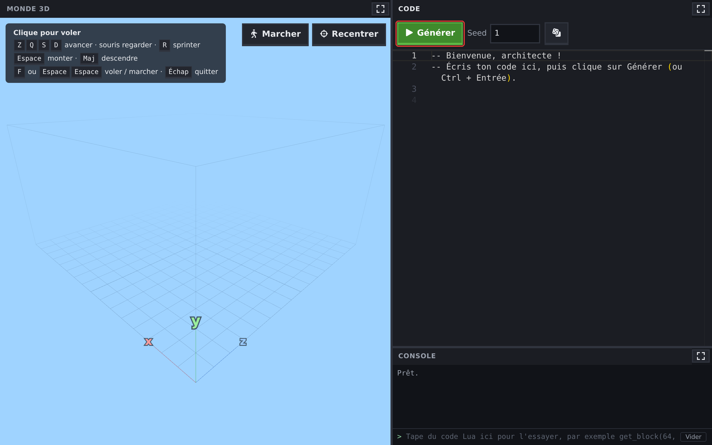
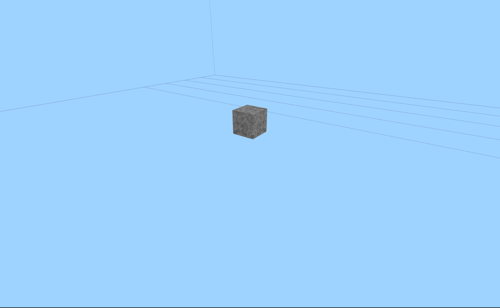
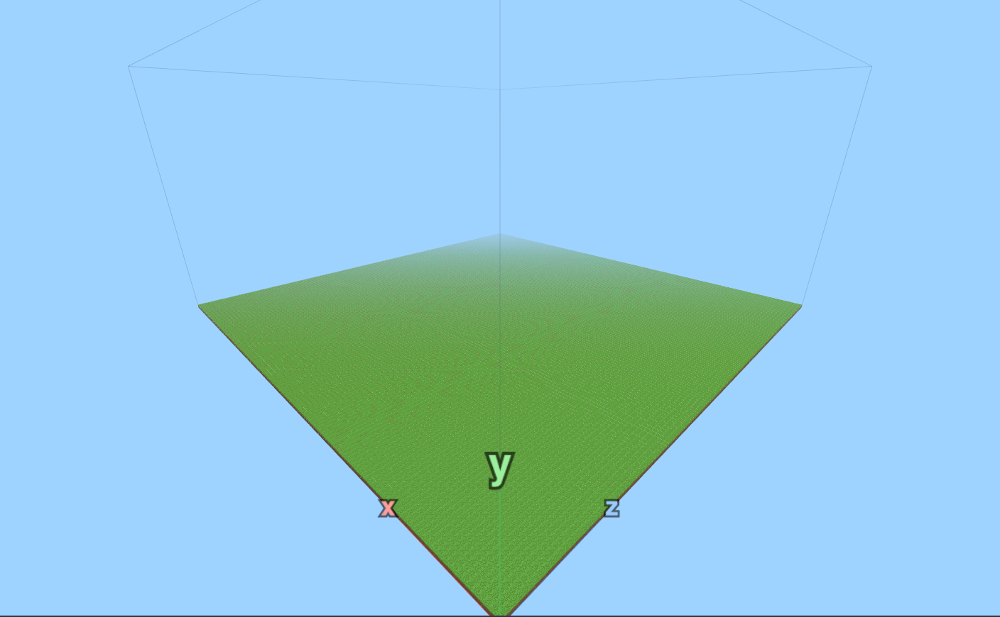
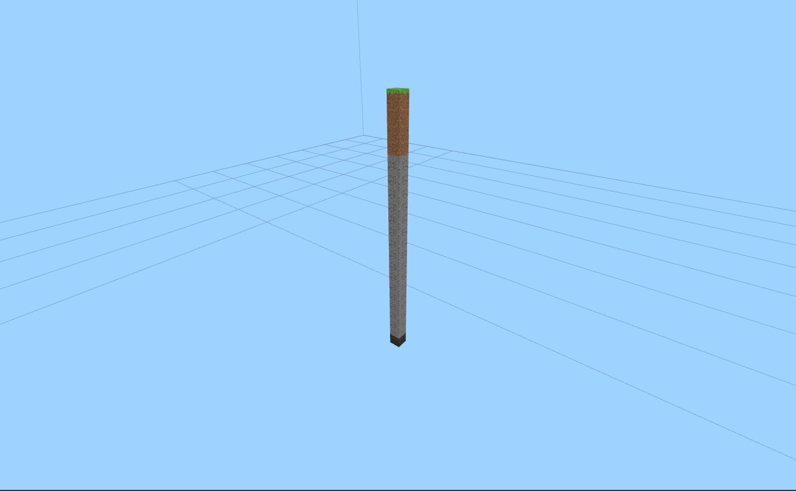
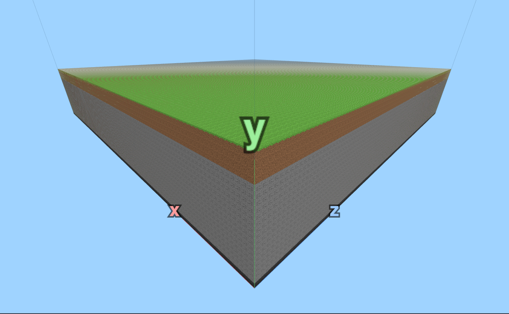
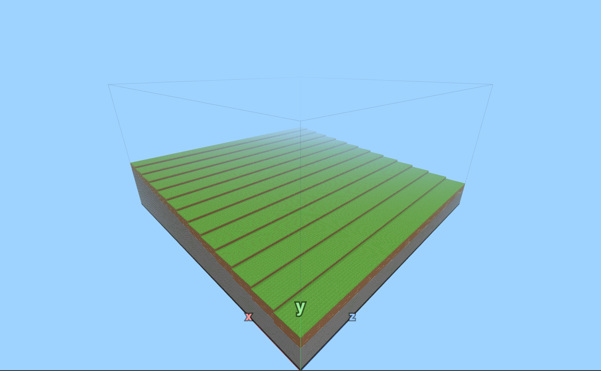

# Partie 1 : du premier bloc à la fonction colonne

Cinq étapes, dans l'ordre. Chacune te donne les outils dont tu as besoin, te prévient des pièges, puis te lance un défi ; quand ton monde est prêt, l'encadrant valide l'étape avec un code de validation. Les indices sont là si tu bloques. D'une étape à l'autre, tu **gardes ton code** et tu le transformes.

**Comment ça marche**

1. Clique sur le bouton **Ouvrir World Generator** : le monde s'ouvre à côté des instructions.
   <!-- ws:cue runtime -->
2. Tu y trouves le monde en 3D, l'éditeur où tu écris ton code, et la **console** sous l'éditeur.
3. Le bouton **▶ Générer** (ou <kbd>Ctrl</kbd> + <kbd>Entrée</kbd>) exécute ton code et construit le monde.
4. Quand tu es prêt à passer à l'étape suivante, demande à un encadrant de valider ce que tu as fait.



## Étape 1 : Premier bloc
<!-- ws: {type: exercise, id: premier-bloc, points: 150, token_id: "1"} -->
<!-- étape de modelage : la ligne de code est donnée volontairement, dans l'indice 2 -->

Bienvenue dans ton monde. Il est encore vide : un ciel bleu, une grille au sol et trois flèches de couleur.

Ici, pas de pioche. Les blocs apparaissent quand tu **écris du code**.

<!-- ws:toolbox -->
### Boîte à outils

> 🧰 **Appeler une fonction : `set_block`**
> Une **fonction** est une action toute prête. On l'appelle en écrivant son nom, puis ses **paramètres** entre parenthèses, séparés par des virgules.
> `set_block` pose un bloc. Ses quatre paramètres : <var>x</var>, <var>y</var>, <var>z</var>, puis le type de bloc.
>
> ```lua
> set_block(64, 10, 64, PIERRE)
> ```

> 🧰 **Les coordonnées <var>x</var>, <var>y</var>, <var>z</var>**
> Regarde les flèches dans le monde : <var>x</var> et <var>z</var> avancent sur le sol, <var>y</var> monte vers le ciel.
> Le monde va de `0` à `127` en <var>x</var> et en <var>z</var>, et de `0` à `63` en hauteur. Le coin avec les flèches, c'est (0, 0, 0).
>
> ```lua
> set_block(0, 0, 0, HERBE)  -- dans le coin, au sol
> set_block(0, 5, 0, HERBE)  -- 5 blocs plus haut
> ```
>
> 
> <!-- ws:anim {src: img/outil-coordonnees.webm, chapters: img/outil-coordonnees.vtt} -->

> 🧰 **Voler et marcher dans le monde**
> **Clique** sur le monde pour prendre le contrôle, puis :
> - <kbd>Z</kbd> <kbd>Q</kbd> <kbd>S</kbd> <kbd>D</kbd> pour avancer et te décaler
> - la **souris** pour regarder autour
> - <kbd>Espace</kbd> pour monter, <kbd>Maj</kbd> pour descendre, <kbd>R</kbd> pour aller vite
> - <kbd>F</kbd>, ou deux fois <kbd>Espace</kbd>, pour **atterrir et marcher** comme dans Minecraft (Espace saute), puis pour reprendre ton envol
> - <kbd>Échap</kbd> pour rendre la souris et revenir au code

> 🧰 **Les types de bloc**
> Le type de bloc s'écrit en **MAJUSCULES** : `PIERRE`, `TERRE`, `HERBE`, `SABLE`, `EAU`, `BOIS`, `FEUILLES`, `NEIGE`, `GLACE`, `GRAVIER`, `CHARBON`, `FER`, `DIAMANT`, `BEDROCK`, et `AIR` pour effacer.
> Tu pourras écrire tes propres constantes en majuscules aussi (`SOL`), mais jamais avec le nom d'un bloc : `pierre` et `PIERRE` sont deux noms différents, et les noms du glossaire sont déjà pris.
>
> ```lua
> set_block(64, 11, 64, DIAMANT)
> ```
<!-- /ws:toolbox -->

### Pièges

- `PIERRE` s'écrit en majuscules et **sans guillemets**. `"pierre"` ne marche pas.
- Le monde ne change que quand tu cliques sur **▶ Générer** (ou <kbd>Ctrl</kbd> + <kbd>Entrée</kbd>).
- Tout ce qui suit `--` sur une ligne est un **commentaire** : Lua l'ignore.

### Défi
<!-- ws:doit -->

Pose un bloc de `PIERRE` au centre du monde, à 10 blocs de hauteur : en (64, 10, 64).

Tu dois obtenir ceci :


<!-- ws:scene {src: scenes/etape1.glb, show_axis: true, camera: {from: [59.5, 13.5, 57.5], to: [64.5, 9, 64.5]}} -->

Ce que tu dois avoir pour valider cette étape :

- Un bloc de pierre en (64, 10, 64)


<!-- ws: {type: hint} -->
<details><summary>Indice 1</summary>

Les trois nombres sont toujours dans l'ordre <var>x</var>, <var>y</var>, <var>z</var>. La hauteur est le **deuxième**.

</details>

<!-- ws: {type: hint} -->
<details><summary>Indice 2</summary>

Une seule ligne suffit : `set_block(64, 10, 64, PIERRE)`

</details>

### Bonus

Construis une petite tour de 5 blocs de haut, puis pose un `DIAMANT` au sommet.

## Étape 2 : Le sol plat
<!-- ws: {type: exercise, id: sol-plat, points: 200, token_id: "2"} -->

Un bloc flotte, tout seul dans le vide. Pour un monde entier, il en faudrait **16 384** (128 × 128) rien que pour le sol. À la main, tu y serais encore à Noël.

Heureusement, un ordinateur sait très bien répéter des actions en boucle.

<!-- ws:toolbox -->
### Boîte à outils

> 🧰 **La boucle `for`**
> Une **boucle** répète le code écrit entre `do` et `end`. Ici, <var>x</var> vaut 0, puis 1, puis 2… jusqu'à 9 : une ligne de 10 blocs.
>
> ```lua
> for x = 0, 9 do
>   set_block(x, 0, 0, PIERRE)
> end
> ```
>
> 
> <!-- ws:anim {src: img/outil-boucle.webm, chapters: img/outil-boucle.vtt} -->

> 🧰 **Une boucle dans une boucle**
> Pour chaque valeur de <var>x</var>, la boucle intérieure fait tous les <var>z</var>. 10 × 10 = un carré de 100 blocs.
>
> ```lua
> for x = 0, 9 do
>   for z = 0, 9 do
>     set_block(x, 0, z, PIERRE)
>   end
> end
> ```
>
> 
> <!-- ws:anim {src: img/outil-double-boucle.webm, chapters: img/outil-double-boucle.vtt} -->

> 🧰 **`TAILLE` « la largeur du monde »**
> `TAILLE` vaut 128, la largeur du monde. <var>x</var> et <var>z</var> vont de `0` à `TAILLE - 1`, c'est-à-dire 127.
>
> ```lua
> print(TAILLE)
> print(TAILLE - 1)
> ```

> 🧰 **`print` « écrire dans la console »**
> `print` écrit dans la console, sous l'éditeur. Quand ton code ne fait pas ce que tu crois, affiche tes variables.
>
> ```lua
> for x = 0, 3 do
>   print("x vaut", x)
> end
> ```
<!-- /ws:toolbox -->

### Pièges

- `for x = 0, TAILLE do` fait **129** tours, pas 128 (de 0 à 128 compris, ça fait 129 nombres) : le dernier bloc tombe hors du monde. La console te le signale.
- Chaque `for` a son `end`. Décale le code à l'intérieur vers la droite pour voir qui ferme quoi.

### Défi
<!-- ws:doit -->

Recouvre tout le sol du monde (<var>y</var> = 0) d'`HERBE` : les 128 × 128 colonnes.

Ce que tu dois avoir pour valider cette étape :
- Tout le sol (en <var>y</var> = 0) est recouvert d'un bloc d'herbe.

Tu dois obtenir quelque chose comme ça :


<!-- ws:scene {src: scenes/etape2.glb, show_axis: true, camera: {from: [-22, 52, -22], to: [64, 0, 64]}} -->

<!-- ws: {type: hint} -->
<details><summary>Indice 1</summary>

Commence par une seule ligne de 128 blocs le long de <var>x</var>. Vole pour vérifier qu'elle touche les deux bords.

</details>

<!-- ws: {type: hint} -->
<details><summary>Indice 2</summary>

Mets ensuite cette boucle **à l'intérieur** d'une autre boucle, sur <var>z</var>.

</details>

<!-- ws: {type: hint} -->
<details><summary>Indice 3</summary>

```lua
for x = 0, TAILLE - 1 do
  for z = 0, TAILLE - 1 do
    ...
  end
end
```

</details>

### Bonus

Fais un damier : `HERBE` et `SABLE` en alternance. Indice : `%` n'est pas un pourcentage, c'est le **reste de la division**. `7 % 2` vaut 1, et `(x + z) % 2` vaut 0 ou 1.

## Étape 3 : Une colonne
<!-- ws: {type: exercise, id: une-colonne, points: 150, validation: checkpoint} -->

Creuse dans Minecraft : sous l'herbe il y a de la terre, puis de la pierre, et tout au fond la **bedrock** que rien ne peut casser.

Ton monde, lui, n'a qu'une pellicule d'un bloc d'épaisseur. Enlève un bloc et on tombe dans le vide.

<!-- ws:toolbox -->
### Boîte à outils

> 🧰 **Les variables**
> Une **variable** est une boîte avec un nom. Change la valeur de `SOL` une seule fois, et tout le code qui l'utilise suit.
>
> ```lua
> local SOL = 20
> set_block(64, SOL, 64, HERBE)
> set_block(64, SOL - 1, 64, TERRE)
> ```
>
> 
> <!-- ws:anim {src: img/outil-variables.webm, chapters: img/outil-variables.vtt} -->

> 🧰 **Une boucle vers le haut**
> La même boucle `for`, mais sur <var>y</var> : une colonne de pierre de <var>y</var> = 1 à <var>y</var> = 16.
>
> ```lua
> for y = 1, 16 do
>   set_block(64, y, 64, PIERRE)
> end
> ```
>
> 
> <!-- ws:anim {src: img/outil-colonne.webm, chapters: img/outil-colonne.vtt} -->

> 🧰 **Calculer avec les variables**
> On peut faire des calculs partout où on attend un nombre : `+`, `-`, `*` (multiplication), `/` (division).
>
> ```lua
> local SOL = 20
> print(SOL - 4, SOL - 3, SOL - 1)
> ```
<!-- /ws:toolbox -->

### Pièges

- Si la pierre va jusqu'à `SOL - 4`, la terre commence à `SOL - 3`. Un chiffre de travers et les couches se chevauchent.
- Si tu poses deux blocs au même endroit, c'est **le dernier** bloc posé qui est gardé.

### Défi
<!-- ws:doit -->

Construis **une seule colonne**, au centre du monde en (64, 64). De bas en haut : `BEDROCK` à <var>y</var> = 0, de la `PIERRE`, exactement 3 blocs de `TERRE`, puis l'`HERBE` au sommet, à la hauteur `SOL`.

Ce que tu dois avoir pour valider cette étape :

- En volant autour, tu vois la bedrock, la pierre, 3 blocs de terre et l'herbe, dans cet ordre.
- Change `SOL` en 30, puis clique sur **▶ Générer** : toute la colonne grandit d'un coup, couches comprises.

Tu dois obtenir quelque chose comme ça :


<!-- ws:scene {src: scenes/etape3.glb, show_axis: true, camera: {from: [50, 23, 46], to: [64.5, 10, 64.5]}} -->

<!-- ws: {type: hint} -->
<details><summary>Indice 1</summary>

Avec `SOL = 20` : bedrock à 0, pierre de 1 à 16, terre de 17 à 19, herbe à 20.

</details>

<!-- ws: {type: hint} -->
<details><summary>Indice 2</summary>

Pour la pierre, une boucle sur <var>y</var> t'évite d'écrire 16 lignes. Pour les 3 blocs de terre, trois `set_block` suffisent ; une boucle marche aussi, comme tu préfères.

</details>

<!-- ws: {type: hint} -->
<details><summary>Indice 3</summary>

Ta colonne ne grandit pas quand tu changes `SOL` ? Cherche les nombres écrits en dur : chaque hauteur doit se calculer à partir de `SOL`.

</details>

## Étape 4 : Le monde en colonnes
<!-- ws: {type: exercise, id: couches, points: 100, token_id: "3"} -->

Une colonne, c'est un bon début. Il en faut **16 384** pour couvrir ton monde. Heureusement, tu sais déjà faire une boucle.

<!-- ws:toolbox -->
### Boîte à outils

> 🧰 **Penser en colonnes**
> Ton monde, c'est 128 × 128 **colonnes**. Une colonne, c'est une pile de blocs posée en (<var>x</var>, <var>z</var>) : la bedrock tout en bas, puis la pierre, la terre, et l'herbe au sommet.
> Si tu sais construire **une** colonne, la double boucle de l'étape 2 construit toutes les autres.
>
> 
> <!-- ws:anim {src: img/outil-colonnes.webm, chapters: img/outil-colonnes.vtt} -->
<!-- /ws:toolbox -->

### Défi
<!-- ws:doit -->

Dans chaque colonne, de bas en haut : `BEDROCK` à <var>y</var> = 0, de la `PIERRE`, exactement 3 blocs de `TERRE`, puis l'`HERBE` au sommet.

Ce que tu dois avoir pour valider cette étape :
- 1 Bedrock, un certain nombre de bloc de pierre, 3 terre, 1 herbe

Pour vérifier encore : change `SOL` en 30, puis clique sur **▶ Générer**. Tout ton monde doit monter d'un coup.

Tu dois obtenir quelque chose comme ça :


<!-- ws:scene {src: scenes/etape4.glb, show_axis: true, features: [orbit, zoom, pan, reset, cut], cut: {axis: x}, camera: {from: [-14, 30, -14], to: [12, 12, 12]}} -->

<!-- ws: {type: hint} -->
<details><summary>Indice 1</summary>

Tu as déjà utilisé les boucles imbriquées avec <var>x</var> et <var>z</var> à l'étape 2.

</details>

<!-- ws: {type: hint} -->
<details><summary>Indice 2</summary>

Dans ta colonne de l'étape 3, <var>x</var> et <var>z</var> valaient 64. Dans la double boucle, ce sont les variables <var>x</var> et <var>z</var> qui prennent leur place.

</details>

### Bonus

Vole sous ton monde (<kbd>Maj</kbd>) et regarde la tranche : on voit les couches sur les bords.

## Étape 5 : La fonction colonne
<!-- ws: {type: exercise, id: colonne-fonction, points: 150, validation: checkpoint} -->
<!-- étape de modelage : la fonction colonne est donnée volontairement dans la boîte à outils -->

Ton monde est totalement plat. Il est temps de lui donner du **relief**.

Pour ça, chaque colonne doit avoir *sa propre* hauteur.

<!-- ws:toolbox -->
### Boîte à outils

> 🧰 **Écrire sa propre fonction avec `function`**
> Tu peux ranger du code sous un nom, puis le réutiliser. <var>x</var>, <var>z</var> et `h` sont les **paramètres** : des variables qui reçoivent les valeurs données à l'appel.
>
> ```lua
> function colonne(x, z, h)
>   set_block(x, 0, z, BEDROCK)
>   -- ... les couches, avec h comme hauteur de l'herbe
>   set_block(x, h, z, HERBE)
> end
>
> colonne(10, 10, 20)
> colonne(11, 10, 25)
> ```
>
> 
> <!-- ws:anim {src: img/outil-fonction.webm, chapters: img/outil-fonction.vtt} -->

> 🧰 **Une hauteur qui dépend de <var>x</var>**
> Ici, plus <var>x</var> est grand, plus le bloc est haut : une ligne d'herbe qui monte, un bloc plus haut tous les 10 blocs. Pas besoin d'arrondir : un bloc ne peut pas être à la hauteur 10,7, `set_block` arrondit vers le bas tout seul.
>
> ```lua
> for x = 0, TAILLE - 1 do
>   local h = 10 + x / 10
>   set_block(x, h, 0, HERBE)
> end
> ```
<!-- /ws:toolbox -->

### Pièges

- Une fonction doit être écrite **avant** la ligne qui l'appelle.
- Dans ta fonction, toutes les couches se calculent à partir de `h` : l'herbe en `h`, la terre juste en dessous.

### Défi
<!-- ws:doit -->

Range la construction d'une colonne dans une fonction `colonne(x, z, h)`. Puis fais monter ton terrain en **pente douce** le long de <var>x</var> : chaque colonne aussi haute que sa voisine, ou un bloc plus haut, avec au moins **8 hauteurs différentes**. Les couches de l'étape 4 restent obligatoires.

Vérifie en volant le long de ta pente.

- elle monte d'un bord du monde à l'autre, sans marche de plus d'un bloc ;
- sur la tranche, chaque colonne a toujours sa bedrock, sa pierre, ses 3 blocs de terre et son herbe.

Tu dois obtenir quelque chose comme ça :


<!-- ws:scene {src: scenes/etape5.glb, show_axis: true, camera: {from: [-30, 72, -30], to: [64, 12, 64]}} -->

<!-- ws: {type: hint} -->
<details><summary>Indice 1</summary>

Transforme le contenu de tes boucles en une fonction `colonne(x, z, h)`, où `SOL` devient `h`. Appelle-la avec la même hauteur partout : ton monde ne doit pas changer.

</details>

<!-- ws: {type: hint} -->
<details><summary>Indice 2</summary>

Dans ta double boucle, juste avant `colonne(x, z, h)`, ajoute une ligne qui calcule `h`. Si `h` ne change pas avec <var>x</var>, toutes les colonnes ont la même hauteur. Si `h` grandit quand <var>x</var> grandit, le terrain monte.

</details>

<!-- ws: {type: hint} -->
<details><summary>Indice 3</summary>

Ta pente monte trop vite ? **Divise** <var>x</var> par un plus grand nombre.

</details>

### Bonus

Fais monter la pente en diagonale : que `h` dépende de <var>x</var> **et** de <var>z</var>.
