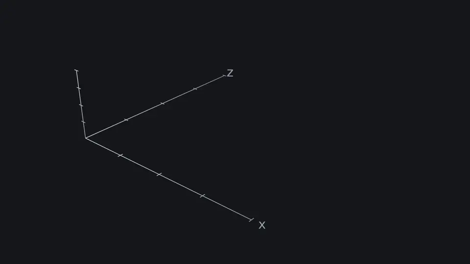
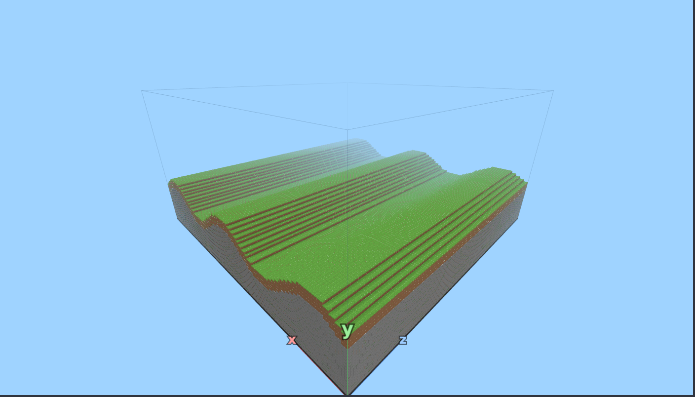
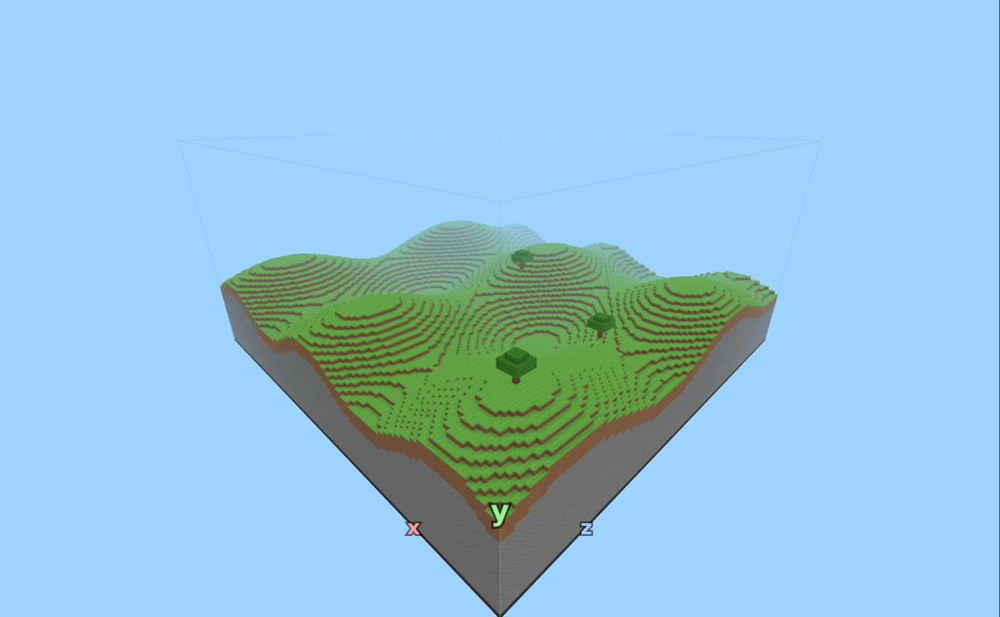
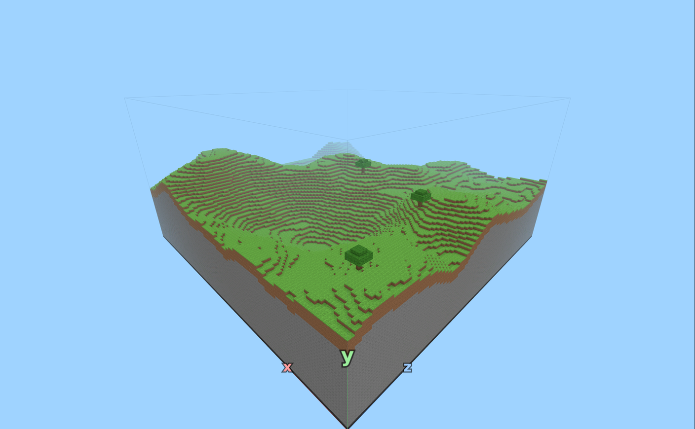
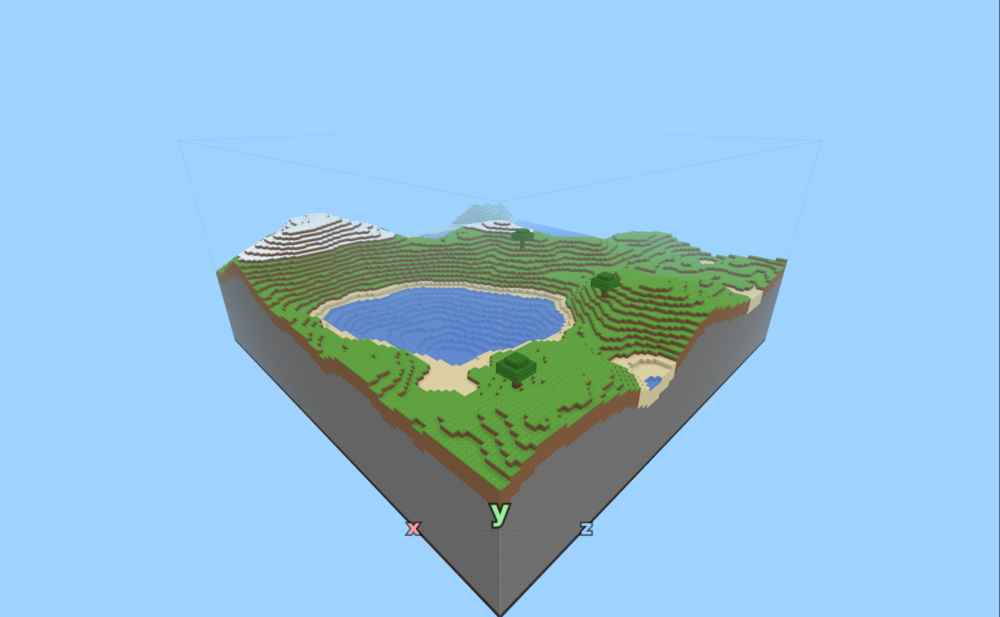
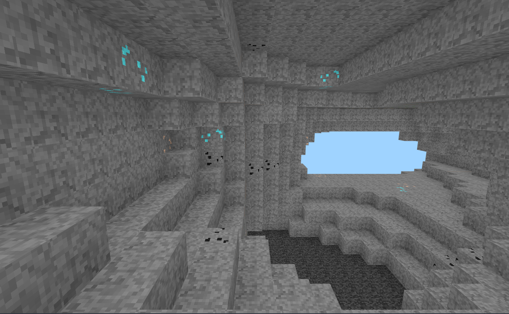

# Partie 2 : des collines au monde entier

Cinq étapes de plus : les vagues, le vrai relief, la mer et la neige, puis les forêts, les grottes et les minerais. Même fonctionnement : les outils, les pièges, le défi, et le code de validation quand c'est réussi. Les couches restent obligatoires à chaque étape.

## Étape 6 : La vague
<!-- ws: {type: exercise, id: collines, points: 200, token_id: "4"} -->

Ta pente monte tout droit, comme une rampe. La nature, elle, fait des bosses et des creux.

<!-- ws:toolbox -->
### Boîte à outils

> 🧰 **`math.sin` « la vague »**
> `math.sin(t)` monte et descend entre -1 et 1, comme une vague. Trois nombres la règlent : la **hauteur**, la **taille**, la **largeur**. L'animation les montre un par un. Dans ta ligne `h` : <var>x</var> divisé par la largeur dans `math.sin( )`, le résultat multiplié par la taille, la hauteur ajoutée devant. `math.` est la boîte à outils de Lua.
>
> 
> <!-- ws:anim {src: img/etape6-vague.webm, chapters: img/etape6-vague.vtt} -->

<!-- /ws:toolbox -->

### Pièges

- `math.sin(x)` tout seul ondule beaucoup trop vite : une vague tous les 6 blocs environ. Divise <var>x</var> pour élargir.
- Une vague trop haute envoie `h` au-dessus de 63 (le ciel) ou sous 5 (plus de place pour les couches).

### Défi
<!-- ws:doit -->

Fais onduler ton terrain le long de <var>x</var> avec `math.sin`. Il te faut au moins **8 hauteurs différentes**, et jamais une marche de plus de **2 blocs** entre deux colonnes voisines.

Ce que tu dois avoir pour valider cette étape :
- Des collines douces avec les bonnes couches

Tu dois obtenir quelque chose comme ça :


<!-- ws:scene {src: scenes/etape6.glb, show_axis: true, camera: {from: [-30, 72, -30], to: [64, 12, 64]}} -->

<!-- ws: {type: hint} -->
<details><summary>Indice 1</summary>

Garde ta fonction `colonne` telle quelle : seule la ligne qui calcule `h` change.

</details>

<!-- ws: {type: hint} -->
<details><summary>Indice 2</summary>

Commence avec une vague de petite taille, par exemple `2 * math.sin(x / 8)`, génère, puis augmente-la.

</details>

<!-- ws: {type: hint} -->
<details><summary>Indice 3</summary>

Si une marche dépasse 2 blocs entre deux colonnes voisines, **divise** <var>x</var> par un plus grand nombre.

</details>

## Étape 7 : Les collines
<!-- ws: {type: exercise, id: collines-deux-sens, points: 150, validation: checkpoint} -->

Ton monde ressemble à une **tôle ondulée** : du relief sur un seul axe.

<!-- ws:toolbox -->
### Boîte à outils

> 🧰 **Une vague en <var>x</var>, une vague en <var>z</var>**
> Une seule vague en <var>x</var> : rien ne change quand tu avances vers le fond, c'est une tôle ondulée. Ajoute une deuxième vague, qui regarde <var>z</var>. Les deux s'additionnent : la tôle devient une **boîte d'œufs**.
>
> 
> <!-- ws:anim {src: img/etape7-collines.webm, chapters: img/etape7-collines.vtt} -->

> 🧰 **Pourquoi deux largeurs différentes ?**
> Si les deux vagues ont la même largeur, leurs bosses tombent toutes au même endroit. Essaie la même largeur pour les deux, puis deux largeurs différentes, et regarde la différence depuis le ciel.
<!-- /ws:toolbox -->

### Pièges

- Si tu écris `math.sin(x / 8 + z / 11)`, c'est **une seule** vague, en diagonale. Il faut deux `math.sin`.

### Défi
<!-- ws:doit -->

Ajoute une deuxième vague qui dépend de <var>z</var>. Ton terrain doit onduler **dans les deux sens** : le long de <var>x</var>, et aussi quand tu voles vers le fond.

Ce que tu dois avoir pour valider cette étape :

- vole vers le fond du monde : ça monte et ça descend ;
- vu du ciel, des bosses et des creux partout, comme une boîte d'œufs.

Tu dois obtenir quelque chose comme ça :


<!-- ws:scene {src: scenes/etape7.glb, show_axis: true, camera: {from: [-30, 72, -30], to: [64, 12, 64]}} -->

<!-- ws: {type: hint} -->
<details><summary>Indice 1</summary>

Ta ligne `h` a déjà une vague qui dépend de <var>x</var>. Ajoute-lui une deuxième vague, écrite de la même façon, mais avec <var>z</var> à la place de <var>x</var> et une autre largeur.

</details>

<!-- ws: {type: hint} -->
<details><summary>Indice 2</summary>

Si le terrain fait des marches trop hautes : ajuste les paramètres de ta vague.

</details>

### Bonus

Multiplie les deux vagues au lieu de les additionner. Que se passe-t-il ?

## Étape 8 : Le vrai relief
<!-- ws: {type: exercise, id: relief, points: 250, token_id: "5"} -->

Vole tout en haut et regarde : tes collines sont alignées comme une boîte d'œufs. La nature ne se répète pas comme ça.

En 1983, pour les effets spéciaux du film *Tron*, Ken Perlin invente un **bruit** qui ressemble au hasard tout en restant doux. Il reçoit un Oscar pour ça. Minecraft s'en sert pour dessiner tous ses terrains.

<!-- ws:toolbox -->
### Boîte à outils

> 🧰 **`perlin2d(x, z)` « un nombre qui varie doucement »**
> `perlin2d` renvoie un nombre entre -1 et 1. Si <var>x</var> et <var>z</var> bougent *un peu*, le résultat bouge *un peu* : c'est ce qui rend les collines douces.
>
> ```lua
> print(perlin2d(10.5, 3.2))
> print(perlin2d(10.6, 3.2))
> print(perlin2d(50.1, 80.7))
> ```
>
> 
> <!-- ws:anim {src: img/etape8-perlin.webm, chapters: img/etape8-perlin.vtt} -->

> 🧰 **L'échelle**
> Mêmes réglages que la vague. Le nombre qui divise <var>x</var> et <var>z</var> fait la **largeur**, celui qui multiplie fait la **taille**, celui que tu ajoutes fait la **hauteur**.

> 🧰 **Les octaves**
> Un seul bruit donne des collines lisses. On en **additionne** plusieurs : un grand pour les montagnes, un moyen pour les bosses, un petit pour les détails. Chacun s'appelle une **octave**, avec sa largeur et sa taille.
>
> 
> <!-- ws:anim {src: img/outil-octaves.webm, chapters: img/outil-octaves.vtt} -->

> 🧰 **La seed**
> La **seed** (la graine, en haut du monde) choisit un bruit parmi des milliards. Même code et même seed : exactement le même monde. Change-la pour en découvrir un autre.
<!-- /ws:toolbox -->

### Pièges

- `perlin2d` avec des nombres **entiers** renvoie toujours 0 : `perlin2d(3, 7)` vaut 0. Divise toujours <var>x</var> et <var>z</var>.

### Défi
<!-- ws:doit -->

Calcule `h` avec `perlin2d`, à la bonne échelle, au lieu de tes deux `math.sin`. Il te faut un relief naturel : au moins **15 blocs** entre le point le plus bas et le plus haut, et aucune falaise de plus de **3 blocs**.

Ce que tu dois avoir pour valider cette étape :
- Un relief naturel fait avec perlin2d

Tu dois obtenir quelque chose comme ça :


<!-- ws:scene {src: scenes/etape8.glb, show_axis: true, features: [orbit, zoom, pan, reset, cut], cut: {axis: x}, camera: {from: [-30, 72, -30], to: [64, 12, 64]}} -->

<!-- ws: {type: hint} -->
<details><summary>Indice 1</summary>

Écris une fonction `hauteur(x, z)` qui renvoie (`return`) la hauteur de la colonne.

</details>

<!-- ws: {type: hint} -->
<details><summary>Indice 2</summary>

Si ton terrain est plat, affiche `perlin2d(x, z)` : as-tu oublié de diviser ?

</details>

<!-- ws: {type: hint} -->
<details><summary>Indice 3</summary>

Pas assez de dénivelé ? Multiplie davantage le grand bruit.

</details>

### Bonus

Mets `math.abs(perlin2d(...))` pour le grand bruit : tu obtiens des crêtes de montagne.

## Étape 9 : Mers, plages et neige
<!-- ws: {type: exercise, id: mers-plages-neige, points: 250, token_id: "6"} -->

Tu as de jolies collines en relief, mais avec de l'herbe partout en surface. Il manque la **mer**, des **plages** et des **sommets enneigés**.

Le bloc du dessus ne sera plus toujours le même : il va dépendre de l'altitude.

<!-- ws:toolbox -->
### Boîte à outils

> 🧰 **`if` « faire un choix »**
> `if` exécute du code seulement si une condition est vraie. `elseif` teste une autre condition, `else` s'occupe de tous les autres cas.
>
> ```lua
> local h = 30
> if h < 20 then
>   print("bas")
> elseif h > 35 then
>   print("haut")
> else
>   print("au milieu")
> end
> ```
>
> 
> <!-- ws:anim {src: img/outil-if.webm, chapters: img/outil-if.vtt} -->

> 🧰 **Les comparaisons**
> `<` plus petit, `>` plus grand, `<=` et `>=` « ou égal », `==` égal, `~=` différent.

> 🧰 **Choisir le bloc du dessus**
> On range le type de bloc dans une variable, et on la change si besoin avant de poser.
>
> ```lua
> local dessus = HERBE
> if h >= 34 then
>   dessus = NEIGE
> end
> set_block(x, h, z, dessus)
> ```
>
> 
> <!-- ws:anim {src: img/outil-dessus.webm, chapters: img/outil-dessus.vtt} -->

> 🧰 **Remplir d'eau**
> De l'eau de `h + 1` jusqu'au niveau de la mer.
>
> ```lua
> local NIVEAU_MER = 22
> for y = h + 1, NIVEAU_MER do
>   set_block(x, y, z, EAU)
> end
> ```
>
> 
> <!-- ws:anim {src: img/outil-eau.webm, chapters: img/outil-eau.vtt} -->

<!-- /ws:toolbox -->

### Pièges

- `=` range une valeur, `==` compare. On écrit `if h == 20 then`.
- L'eau se pose **au-dessus** du sol, jamais à sa place.
- `h` à virgule ? `for y = 21.5, 22` ne fait qu'un tour : il manque la couche du dessus de la mer. Arrondis `h` avec `math.floor` dans ta fonction `hauteur`.
- Si `NIVEAU_MER` est plus bas que tout ton terrain, il n'y aura pas de mer du tout.
- `NEIGE`, c'est le bloc. Écris `NEIGE = 30` et `set_block` reçoit 30 à la place du bloc. Appelle ta hauteur de neige `NIVEAU_NEIGE`, comme `NIVEAU_MER`.

### Défi
<!-- ws:doit -->

Ajoute une **mer** à hauteur fixe, du `SABLE` partout où le sol touche l'eau, et de la `NEIGE` au sommet des montagnes.

Ce que tu dois avoir pour valider cette étape :
- Une mer, des plages et de la neige

Tu dois obtenir quelque chose comme ça :


<!-- ws:scene {src: scenes/etape9.glb, show_axis: true, features: [orbit, zoom, pan, reset, cut], cut: {axis: z}, camera: {from: [-30, 72, -30], to: [64, 12, 64]}} -->

<!-- ws: {type: hint} -->
<details><summary>Indice 1</summary>

Choisis `NIVEAU_MER` pour qu'une partie de ton terrain soit dessous. Affiche quelques hauteurs pour t'aider.

</details>

<!-- ws: {type: hint} -->
<details><summary>Indice 2</summary>

Une plage, c'est une colonne à peine plus haute que la mer : `h <= NIVEAU_MER + 1`.

</details>

<!-- ws: {type: hint} -->
<details><summary>Indice 3</summary>

Mets aussi du sable sous l'eau, à la place de l'herbe et de la terre.

</details>

## Étape 10 : Forêts, grottes et minerais
<!-- ws: {type: exercise, id: forets-grottes-minerais, points: 350, token_id: "7"} -->

Ton monde a des mers, des plages et des montagnes. Il est prêt à accueillir la vie… et les mineurs.

Il manque des **arbres** en surface et, sous tes pieds, des **grottes** remplies de **trésors**. Dernière ligne droite avant un générateur complet !

<!-- ws:toolbox -->
### Boîte à outils

> 🧰 **`random(a, b)` « lancer un dé »**
> `random(1, 6)` donne un nombre entier entre 1 et 6, comme un dé. Il dépend de la seed : même seed, mêmes tirages, donc même monde.
>
> ```lua
> print(random(1, 6), random(1, 6), random(0, TAILLE - 1))
> ```

> 🧰 **`get_block` et `while` « trouver le sol »**
> `get_block(x, y, z)` dit quel bloc se trouve à un endroit. `while` répète *tant que* la condition est vraie : on descend depuis le ciel jusqu'au sol. `and` est vrai seulement si les deux conditions sont vraies.
>
> ```lua
> local x, z = 64, 64
> local y = HAUTEUR - 1
> while y > 0 and get_block(x, y, z) == AIR do
>   y = y - 1
> end
> print("le sol est à y =", y)
> ```
>
> 
> <!-- ws:anim {src: img/outil-sol.webm, chapters: img/outil-sol.vtt} -->

> 🧰 **Une fonction arbre**
> Un tronc de 5 blocs, puis des feuilles autour du haut. À toi de compléter la couronne. `y` est la case juste **au-dessus** de l'herbe : appelle `arbre(x, y + 1, z)` quand ton `y` est le sol.
>
> ```lua
> function arbre(x, y, z)
>   for i = 0, 4 do
>     set_block(x, y + i, z, BOIS)
>   end
>   set_block(x, y + 5, z, FEUILLES)
> end
> ```
>
> 
> <!-- ws:anim {src: img/outil-arbre.webm, chapters: img/outil-arbre.vtt} -->

> 🧰 **`perlin3d` « creuser des grottes »**
> Même idée que `perlin2d`, mais en 3D. Là où il dépasse un seuil, on **ne pose pas** de pierre : ça fait un trou.
>
> ```lua
> if perlin3d(x / 16, y / 10, z / 16) > 0.3 then
>   -- grotte : on ne pose rien
> else
>   set_block(x, y, z, PIERRE)
> end
> ```
>
> 
> <!-- ws:anim {src: img/outil-grottes.webm, chapters: img/outil-grottes.vtt} -->

> 🧰 **`return` « une fonction qui répond »**
> Une fonction peut **renvoyer** une valeur. Ici, elle choisit quel bloc poser.
>
> ```lua
> function pierre(y)
>   if y < 12 and random(1, 200) == 1 then
>     return DIAMANT
>   end
>   return PIERRE
> end
>
> print(pierre(5))
> ```
<!-- /ws:toolbox -->

### Pièges

- Une boucle `while` dont la condition reste toujours vraie ne s'arrête jamais : ton code est coupé au bout de 5 secondes.
- Si une grotte touche la surface, elle fait un trou dans le sol, et l'eau se retrouve à flotter au-dessus.
- Les arbres poussent sur l'herbe : pas dans l'eau, ni sur le sable, ni dans le vide.

### Défi
<!-- ws:doit -->

Trois défis. Au moins **10 arbres** plantés sur l'herbe. Des **grottes** creusées avec `perlin3d`. Des **minerais** : du `CHARBON` partout, du `DIAMANT` seulement tout au fond (<var>y</var> < 12).

Ce que tu dois avoir pour valider cette étape :
- Au moins 10 arbres
- Des grottes creusées avec perlin3d
- Charbon, et diamants tout au fond

Tu dois obtenir quelque chose comme ça :


<!-- ws:scene {src: scenes/etape10.glb, show_axis: true, features: [orbit, zoom, pan, reset, cut], cut: {axis: x}, camera: {from: [-18, 58, -18], to: [50, 20, 50]}} -->

Et sous tes pieds :



<!-- ws: {type: hint} -->
<details><summary>Indice 1</summary>

Tire <var>x</var> et <var>z</var> au hasard, cherche le sol avec `while`, et plante seulement si `get_block(x, y, z) == HERBE`.

</details>

<!-- ws: {type: hint} -->
<details><summary>Indice 2</summary>

Plante les arbres **après** la double boucle du terrain, sinon il n'y a pas encore de sol.

</details>

<!-- ws: {type: hint} -->
<details><summary>Indice 3</summary>

Ne creuse pas trop près de la surface : seulement si `y < h - 5`, par exemple.

</details>

<!-- ws: {type: hint} -->
<details><summary>Indice 4</summary>

Remplace `PIERRE` par l'appel d'une fonction qui renvoie parfois un minerai.

</details>

### Bonus

**Défi libre** : invente des biomes. Un deuxième bruit très large peut décider d'une zone de désert (sable, pas d'arbres) ou d'une forêt dense. Puis partage ta seed préférée !

## Et maintenant

Tu es parti d'un bloc. Ton code dessine maintenant un monde entier, avec ses montagnes, ses mers, ses forêts et ses grottes, et il tient en quelques dizaines de lignes. C'est exactement comme ça que Minecraft fabrique les siens.

Change la seed, promène-toi, et garde ton code : la prochaine idée est la tienne.
