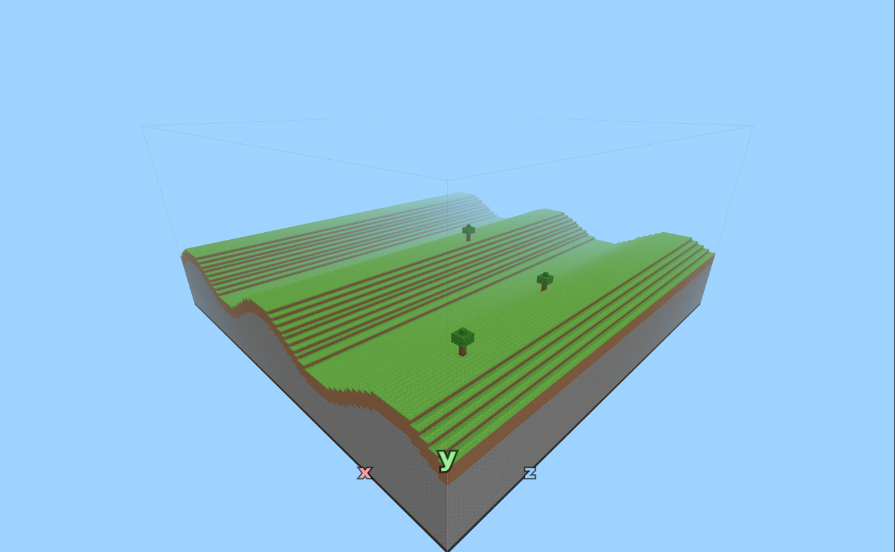
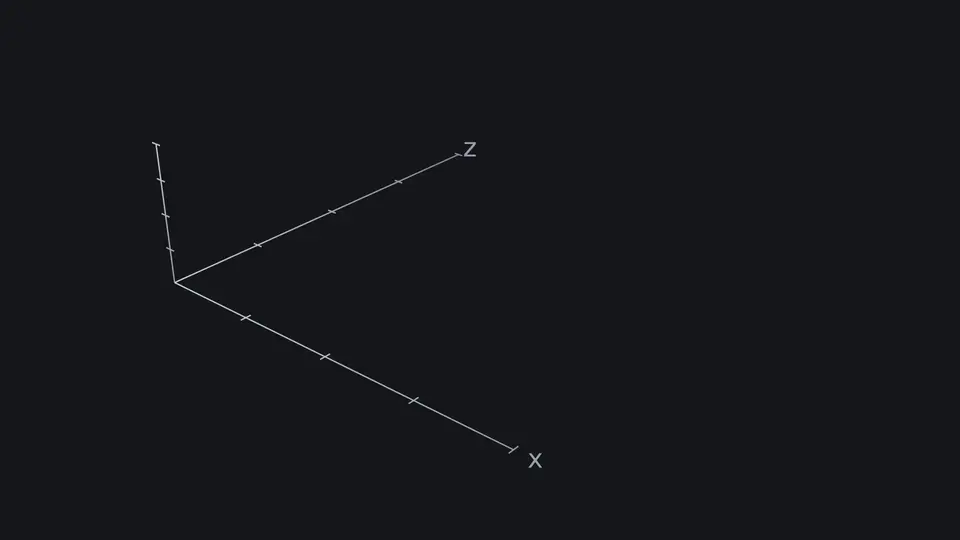
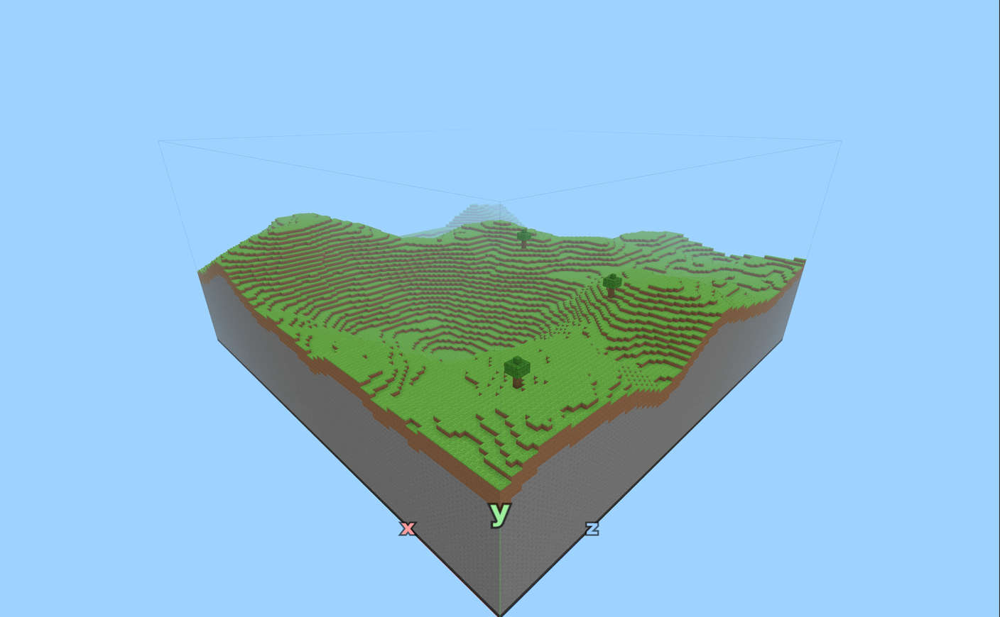
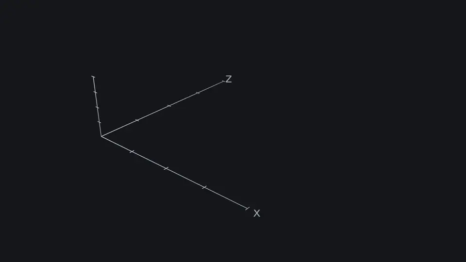
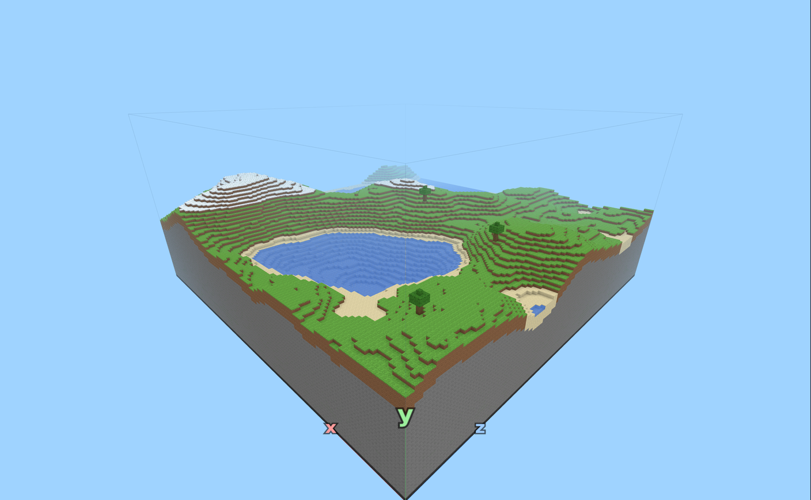
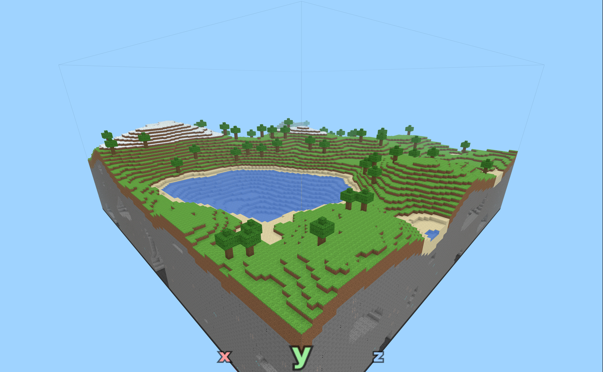
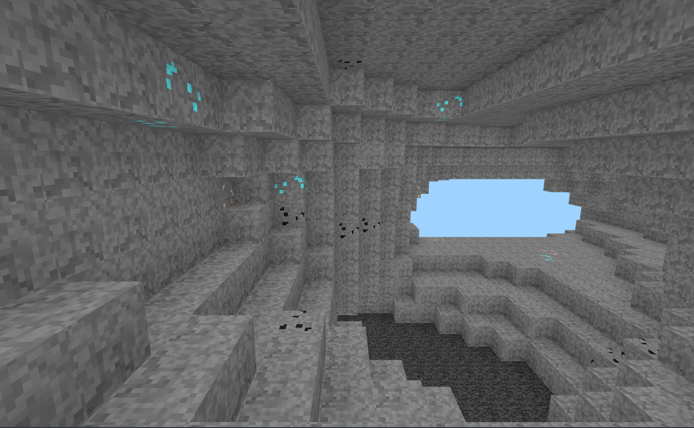

# Partie 2 : des collines au monde entier

Cinq étapes de plus : les vagues, le vrai relief, la mer et la neige, puis les grottes et les minerais. Même fonctionnement : les outils, les pièges, le défi, et le code de validation quand c'est réussi. Les couches restent obligatoires à chaque étape.

## Étape 8 : La vague
<!-- ws: {type: exercise, id: collines, points: 200, token_id: "4"} -->

Ta pente monte tout droit, comme une rampe. La nature, elle, fait des bosses et des creux.

<!-- ws:toolbox -->
### Boîte à outils

> 🧰 **`math.sin` « la vague »**
> `math.sin(t)` monte et descend entre -1 et 1, comme une vague. Trois nombres la règlent : le **niveau**, l'**amplitude**, la **largeur**. L'animation les montre un par un. Dans ta ligne `h` : <var>x</var> divisé par la largeur dans `math.sin( )`, le résultat multiplié par l'amplitude, le niveau ajouté devant. `math.` est la boîte à outils de Lua.
>
> 
> <!-- ws:anim {src: img/etape8-vague.webm, chapters: img/etape8-vague.vtt} -->

<!-- /ws:toolbox -->

### Pièges

- `math.sin(x)` tout seul ondule beaucoup trop vite : une vague tous les 6 blocs environ. Divise <var>x</var> pour élargir.
- Une vague trop haute envoie `h` au-dessus de 63 (le ciel) ou sous 5 (plus de place pour les couches).

### Défi
<!-- ws:doit -->

Fais onduler ton terrain le long de <var>x</var> avec `math.sin` : des bosses et des creux qui se répètent, sans falaise.

Ce que tu dois avoir pour valider cette étape :
- Des collines douces avec les bonnes couches

Tu dois obtenir quelque chose comme ça :


<!-- ws:scene {src: scenes/etape8.glb, show_axis: true, camera: {from: [-30, 72, -30], to: [64, 12, 64]}} -->

<!-- ws: {type: hint} -->
<details><summary>Indice 1</summary>

Garde ta fonction `colonne` telle quelle : seule la ligne qui calcule `h` change.

</details>

<!-- ws: {type: hint} -->
<details><summary>Indice 2</summary>

Commence avec une petite amplitude, 2 par exemple. Génère, puis augmente-la.

</details>

<!-- ws: {type: hint} -->
<details><summary>Indice 3</summary>

Des falaises ? **Divise** <var>x</var> par un plus grand nombre.

</details>

## Étape 9 : Les collines
<!-- ws: {type: exercise, id: collines-deux-sens, points: 150, validation: checkpoint} -->

Ton monde ressemble à une **tôle ondulée** : du relief sur un seul axe.

<!-- ws:toolbox -->
### Boîte à outils

> 🧰 **Une vague en <var>x</var>, une vague en <var>z</var>**
> Une seule vague en <var>x</var> : rien ne change quand tu avances vers le fond, c'est une tôle ondulée. Ajoute une deuxième vague, qui regarde <var>z</var>. Les deux s'additionnent : la tôle devient une **boîte d'œufs**.
>
> 
> <!-- ws:anim {src: img/etape9-collines.webm, chapters: img/etape9-collines.vtt} -->

> 🧰 **Pourquoi deux largeurs différentes ?**
> Si les deux vagues ont la même largeur, leurs bosses tombent toutes au même endroit. Essaie la même largeur pour les deux, puis deux largeurs différentes, et regarde la différence depuis le ciel.
<!-- /ws:toolbox -->

### Pièges

- Si tu mets <var>x</var> et <var>z</var> dans le **même** `math.sin`, tu obtiens **une seule** vague, en diagonale. Il faut deux `math.sin`.

### Défi
<!-- ws:doit -->

Ajoute une deuxième vague qui dépend de <var>z</var>. Ton terrain doit onduler **dans les deux sens** : le long de <var>x</var>, et aussi quand tu voles vers le fond.

Ce que tu dois avoir pour valider cette étape :

- vole vers le fond du monde : ça monte et ça descend ;
- vu du ciel, des bosses et des creux partout, comme une boîte d'œufs.

Tu dois obtenir quelque chose comme ça :


<!-- ws:scene {src: scenes/etape9.glb, show_axis: true, camera: {from: [-30, 72, -30], to: [64, 12, 64]}} -->

<!-- ws: {type: hint} -->
<details><summary>Indice 1</summary>

Ta ligne `h` a déjà une vague qui dépend de <var>x</var>. Ajoute-lui une deuxième vague, écrite de la même façon, mais avec <var>z</var> à la place de <var>x</var> et une autre largeur.

</details>

<!-- ws: {type: hint} -->
<details><summary>Indice 2</summary>

Si le terrain fait des marches trop hautes : ajuste les paramètres de ta vague.

</details>

### Bonus

Multiplie les deux vagues au lieu de les additionner. Que se passe-t-il ?

## Étape 10 : Le vrai relief
<!-- ws: {type: exercise, id: relief, points: 250, token_id: "5"} -->

Vole tout en haut et regarde : la nature ne se répète pas comme ça.

Après avoir travaillé sur les effets spéciaux de *Tron* (1982), Ken Perlin trouve les images de synthèse trop lisses, trop « machine ». En 1983, il invente un **bruit** qui ressemble au hasard tout en restant doux : une suite de nombres qui a l'air tirée au sort. Il reçoit un Oscar technique pour ça. Minecraft s'en sert pour dessiner tous ses terrains.

<!-- ws:toolbox -->
### Boîte à outils

> 🧰 **`perlin2d(x, z)` « un nombre qui varie doucement »**
> `perlin2d` renvoie un nombre entre -1 et 1. Si <var>x</var> et <var>z</var> bougent *un peu*, le résultat bouge *un peu* : c'est ce qui rend les collines douces.
>
> ```lua
> print(perlin2d(10.5, 3.2))
> print(perlin2d(10.6, 3.2))
> print(perlin2d(50.1, 80.7))
> ```
>
> 
> <!-- ws:anim {src: img/etape10-perlin.webm, chapters: img/etape10-perlin.vtt} -->

> 🧰 **L'échelle**
> Mêmes réglages que la vague. Le nombre qui divise <var>x</var> et <var>z</var> fait la **largeur**, celui qui multiplie fait l'**amplitude**, celui que tu ajoutes fait le **niveau**.
>
> 
> <!-- ws:anim {src: img/etape10-relief.webm, chapters: img/etape10-relief.vtt} -->

> 🧰 **`return` « une fonction qui répond »**
> Une fonction peut **renvoyer** une valeur avec `return` : celui qui l'appelle la récupère.
>
> ```lua
> function double(n)
>   return n * 2
> end
>
> print(double(21))
> ```

> 🧰 **Les octaves**
> Un seul bruit donne des collines lisses. On en **additionne** plusieurs : un grand pour les montagnes, un moyen pour les bosses, un petit pour les détails. Chacun s'appelle une **octave**, avec sa largeur et son amplitude.
>
> 
> <!-- ws:anim {src: img/outil-octaves.webm, chapters: img/outil-octaves.vtt} -->

> 🧰 **La seed**
> La **seed** (la graine, en haut du monde) choisit un bruit parmi des milliards. Même code et même seed : exactement le même monde. Change-la pour en découvrir un autre.
<!-- /ws:toolbox -->

### Pièges

- `perlin2d` avec des nombres **entiers** renvoie toujours 0 : `perlin2d(3, 7)` vaut 0. Divise toujours <var>x</var> et <var>z</var>.

### Défi
<!-- ws:doit -->

Calcule `h` avec `perlin2d`, à la bonne échelle, au lieu de tes deux `math.sin`. Tu veux un relief qui ressemble à un vrai paysage : des vallées et des sommets bien marqués, et des pentes qu'on peut descendre à pied.

Ce que tu dois avoir pour valider cette étape :
- Un relief naturel fait avec perlin2d : des sommets, des vallées, pas de falaise

Tu dois obtenir quelque chose comme ça :


<!-- ws:scene {src: scenes/etape10.glb, show_axis: true, features: [orbit, zoom, pan, reset, cut], cut: {axis: x}, camera: {from: [-30, 72, -30], to: [64, 12, 64]}} -->

<!-- ws: {type: hint} -->
<details><summary>Indice 1</summary>

Écris une fonction `hauteur(x, z)` qui renvoie (`return`) la hauteur de la colonne.

</details>

<!-- ws: {type: hint} -->
<details><summary>Indice 2</summary>

Si ton terrain est plat, affiche `perlin2d(x, z)` : as-tu oublié de diviser ?

</details>

<!-- ws: {type: hint} -->
<details><summary>Indice 3</summary>

Ton relief est trop plat ? Multiplie davantage.

</details>

### Bonus

Mets `math.abs(perlin2d(...))` pour le grand bruit : tu obtiens des crêtes de montagne.

## Étape 11 : Mers, plages et neige
<!-- ws: {type: exercise, id: mers-plages-neige, points: 250, token_id: "6"} -->

Tu as de jolies collines en relief, mais avec de l'herbe partout en surface. Il manque la **mer**, des **plages** et des **sommets enneigés**.

Le bloc du dessus ne sera plus toujours le même : il va dépendre de l'altitude.

<!-- ws:toolbox -->
### Boîte à outils

> 🧰 **`if` « faire un choix »**
> `if` exécute du code seulement si une condition est vraie. `elseif` teste une autre condition, `else` s'occupe de tous les autres cas.
>
> ```lua
> h = 30
> if h < 20 then
>   print("bas")
> elseif h > 35 then
>   print("haut")
> else
>   print("au milieu")
> end
> ```
>
> 
> <!-- ws:anim {src: img/outil-if.webm, chapters: img/outil-if.vtt} -->

> 🧰 **Les comparaisons**
> `<` plus petit, `>` plus grand, `<=` et `>=` « ou égal », `==` égal, `~=` différent.

> 🧰 **Choisir le bloc avant de le poser**
> On stocke le type de bloc dans une variable, et on la change si besoin avant de poser. Ici, une ligne de blocs : de l'herbe, puis de la neige à partir de `SEUIL`.
>
> ```lua
> SEUIL = 10
> for x = 0, 20 do
>   bloc = HERBE
>   if x >= SEUIL then
>     bloc = NEIGE
>   end
>   set_block(x, 40, 0, bloc)
> end
> ```
>
> 
> <!-- ws:anim {src: img/outil-dessus.webm, chapters: img/outil-dessus.vtt} -->

> 🧰 **Une boucle qui ne fait aucun tour**
> Si le départ est plus grand que l'arrivée, la boucle ne fait rien. Pratique pour la mer : l'eau remplit les cases vides entre le sol et le niveau de la mer, et là où le sol dépasse, il n'y a rien à remplir. Stocke le niveau de la mer dans une variable `NIVEAU_MER`.
>
> ```lua
> for y = 5, 8 do
>   print("tour", y)
> end
> for y = 9, 8 do
>   print("jamais affiché")
> end
> ```
>
> 
> <!-- ws:anim {src: img/outil-eau.webm, chapters: img/outil-eau.vtt} -->

<!-- /ws:toolbox -->

### Pièges

- `=` stocke une valeur, `==` compare. On écrit `if h == 20 then`.
- L'eau se pose **au-dessus** du sol, jamais à sa place.
- `h` à virgule ? `for y = 21.5, 22` ne fait qu'un tour : il manque la couche du dessus de la mer. Arrondis `h` dans ta fonction `hauteur` : `math.floor(21.5)` vaut 21.
- Si `NIVEAU_MER` est plus bas que tout ton terrain, il n'y aura pas de mer du tout.
- Tes arbres de l'étape 7 restent plantés après la double boucle : grâce au test `== HERBE`, aucun ne pousse dans la mer ni sur le sable.
- `NEIGE`, c'est le bloc. Écris `NEIGE = 30` et `set_block` reçoit 30 à la place du bloc. Appelle ta hauteur de neige `NIVEAU_NEIGE`, comme `NIVEAU_MER`.

### Défi
<!-- ws:doit -->

Ajoute une **mer** à hauteur fixe, du `SABLE` partout où le sol touche l'eau, et de la `NEIGE` au sommet des montagnes.

Ce que tu dois avoir pour valider cette étape :
- Une mer, des plages et de la neige

Tu dois obtenir quelque chose comme ça :


<!-- ws:scene {src: scenes/etape11.glb, show_axis: true, features: [orbit, zoom, pan, reset, cut], cut: {axis: z}, camera: {from: [-30, 72, -30], to: [64, 12, 64]}} -->

<!-- ws: {type: hint} -->
<details><summary>Indice 1</summary>

Choisis `NIVEAU_MER` pour qu'une partie de ton terrain soit dessous. Affiche quelques hauteurs pour t'aider.

</details>

<!-- ws: {type: hint} -->
<details><summary>Indice 2</summary>

Une plage, c'est une colonne à peine plus haute que la mer.

</details>

<!-- ws: {type: hint} -->
<details><summary>Indice 3</summary>

Mets aussi du sable sous l'eau, à la place de l'herbe et de la terre.

</details>

## Étape 12 : Grottes et minerais
<!-- ws: {type: exercise, id: forets-grottes-minerais, points: 350, token_id: "7"} -->

Ton monde a des mers, des plages et des montagnes. Il est prêt à accueillir la vie… et les mineurs.

Il manque, sous tes pieds, des **grottes** remplies de **minerais**. Dernière ligne droite avant un générateur complet !

<!-- ws:toolbox -->
### Boîte à outils

> 🧰 **`perlin3d` « creuser des grottes »**
> Même idée que `perlin2d`, mais en 3D : un nombre entre -1 et 1 pour chaque case. Divise <var>x</var>, <var>y</var> et <var>z</var>, comme à l'étape 10. Là où le nombre dépasse un seuil, tu **ne poses pas** de pierre : ça fait un trou.
>
> ```lua
> print(perlin3d(1.5, 2.5, 3.5))
> print(perlin3d(1.6, 2.5, 3.5))
> ```
>
> 
> <!-- ws:anim {src: img/outil-grottes.webm, chapters: img/outil-grottes.vtt} -->

> 🧰 **Une fonction qui choisit le bloc**
> La fonction renvoie le bloc à poser. `random(1, 2) == 1` est vrai 50 % du temps. `random(1, 100) == 1` est vrai 1 % du temps.
>
> ```lua
> function pile_ou_face()
>   if random(1, 2) == 1 then
>     return SABLE
>   end
>   return NEIGE
> end
>
> set_block(64, 50, 64, pile_ou_face())
> ```
<!-- /ws:toolbox -->

### Pièges

- Si une grotte touche la surface, elle fait un trou dans le sol, et l'eau se retrouve à flotter au-dessus.

### Défi
<!-- ws:doit -->

Deux défis. Creuse des **grottes** avec `perlin3d`. Glisse des **minerais** dans la pierre : du charbon un peu partout, du diamant seulement tout au fond.

Ce que tu dois avoir pour valider cette étape :
- Des grottes sous tes pieds
- Du charbon, et des diamants tout au fond

Tu dois obtenir quelque chose comme ça :


<!-- ws:scene {src: scenes/etape12.glb, show_axis: true, features: [orbit, zoom, pan, reset, cut], cut: {axis: x}, camera: {from: [-18, 58, -18], to: [50, 20, 50]}} -->

Et sous tes pieds :



<!-- ws: {type: hint} -->
<details><summary>Indice 1</summary>

Dans `perlin3d`, divise <var>x</var>, <var>y</var> et <var>z</var> par 16, et prends 0.3 comme seuil. Si tu divises par 32, les grottes sont plus larges et plus éloignées les unes des autres.

</details>

<!-- ws: {type: hint} -->
<details><summary>Indice 2</summary>

Ne creuse pas trop près de la surface : seulement si `y < h - 5`, par exemple.

</details>

<!-- ws: {type: hint} -->
<details><summary>Indice 3</summary>

Remplace `PIERRE` par l'appel d'une fonction qui renvoie parfois un minerai.

</details>

### Bonus

**Défi libre** : invente des biomes. Un deuxième bruit très large peut décider d'une zone de désert (sable, pas d'arbres) ou d'une forêt dense. Puis partage ta seed préférée !

## Et maintenant

Tu es parti d'un bloc. Ton code dessine maintenant un monde entier, avec ses montagnes, ses mers, ses forêts et ses grottes, et il tient en quelques dizaines de lignes. C'est exactement comme ça que Minecraft fabrique les siens.

Change la seed, promène-toi, et garde ton code : la prochaine idée est la tienne.
