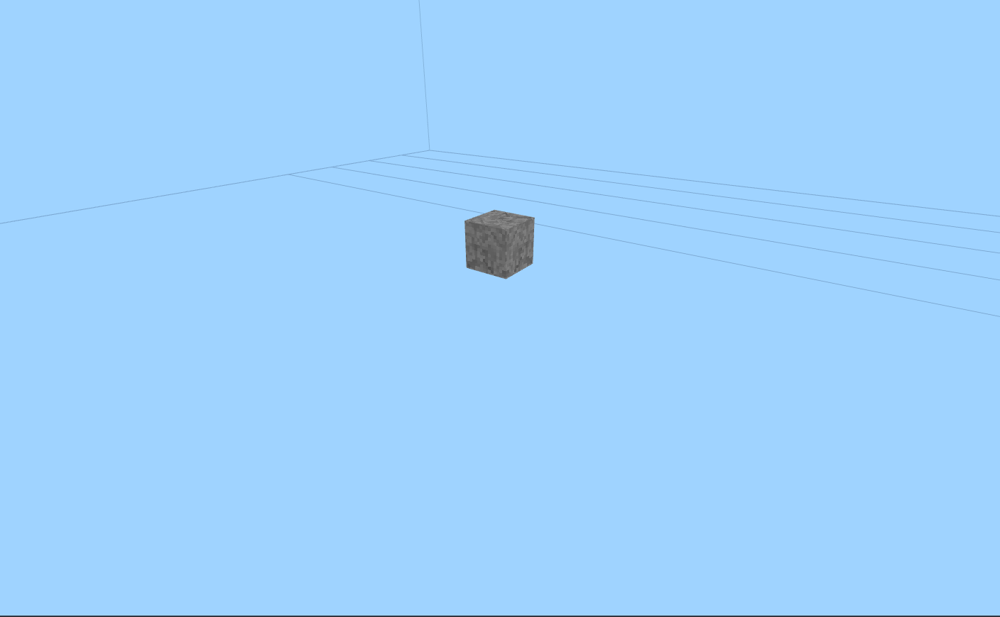
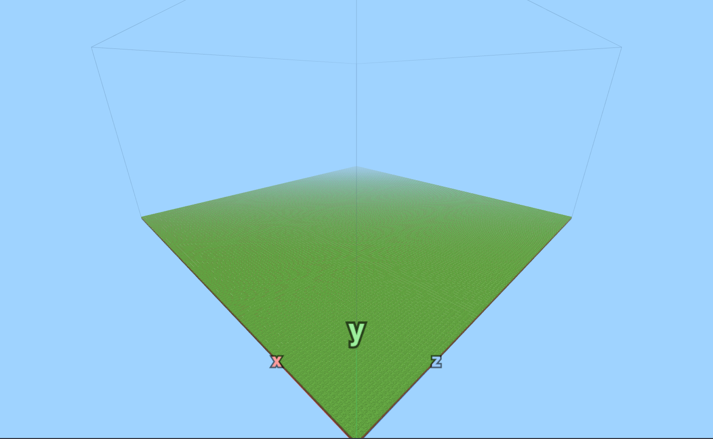
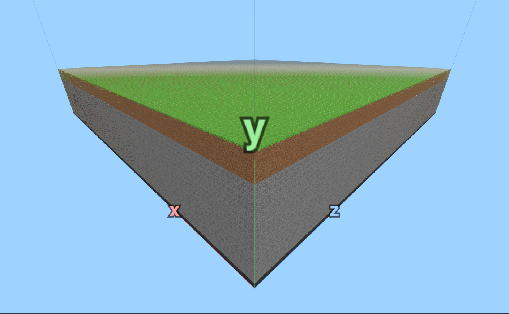
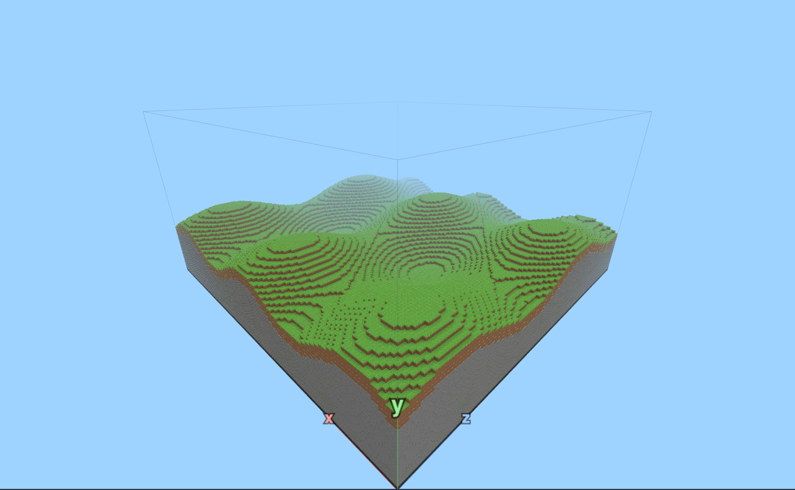
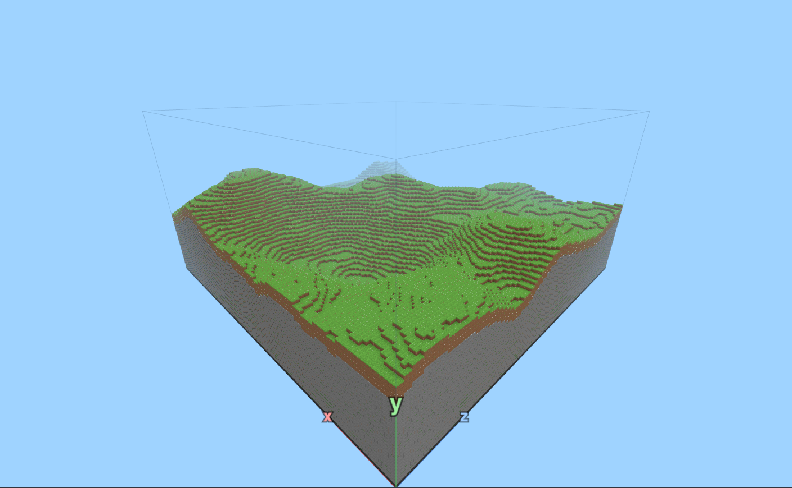
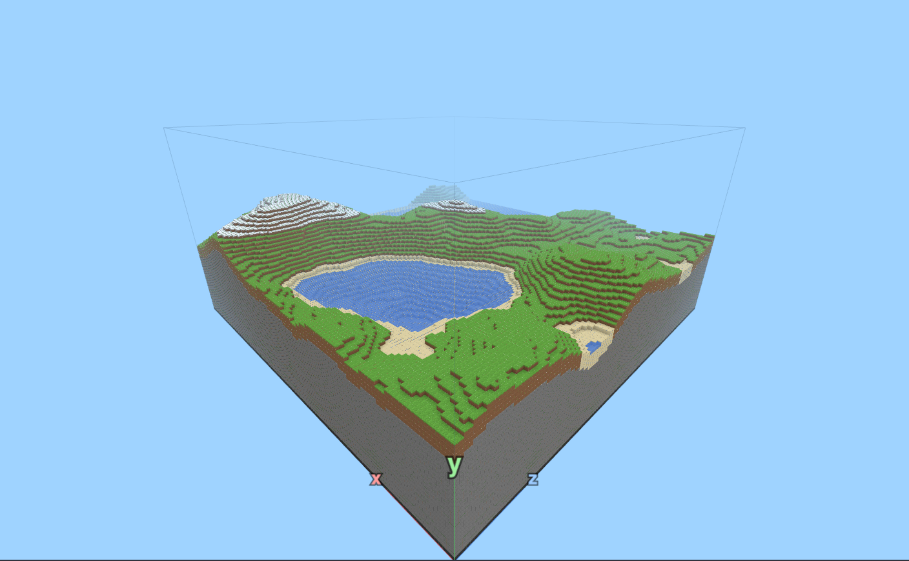
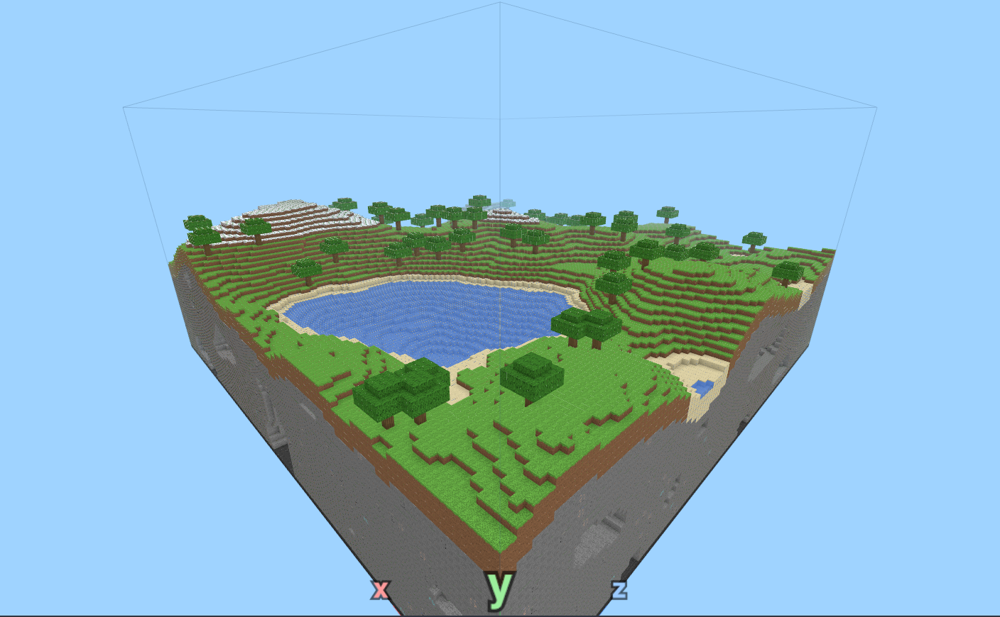
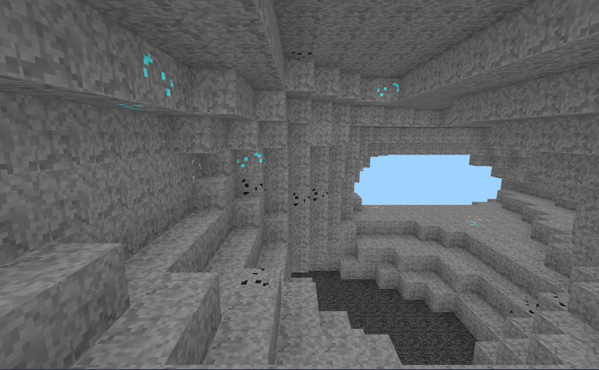

# Du premier bloc au monde entier

Sept étapes, dans l'ordre. Chacune te raconte un bout d'histoire, te donne les outils dont tu as besoin, te prévient des pièges, puis te lance un défi que « ▶ Générer » vérifie tout seul. Les indices sont là si tu bloques, et un bonus t'attend quand tu as fini en avance.

## Étape 1 : Premier bloc
<!-- ws: {type: exercise, id: premier-bloc, points: 150, token_id: "1"} -->
<!-- étape de modelage : la ligne de code est donnée volontairement, dans l'indice 2 -->

*Durée : 15 min*

### Histoire

Le serveur a planté. Quand tu te reconnectes, il ne reste **rien** : un ciel bleu, une grille au sol et trois flèches de couleur. Un message s'affiche : *« Monde introuvable. Mode architecte activé. »*

Ici, pas de pioche. Les blocs apparaissent quand tu **écris du code**.

<!-- ws:toolbox -->
### Boîte à outils

> 🧰 **Appeler une fonction : `bloc`**
> Une **fonction** est une action toute prête. On l'appelle en écrivant son nom, puis ses **paramètres** entre parenthèses, séparés par des virgules.
> `bloc` pose un bloc. Ses quatre paramètres : x, y, z, puis le type de bloc.
>
> ```lua
> bloc(64, 10, 64, PIERRE)
> ```

> 🧰 **Les coordonnées x, y, z**
> Regarde les flèches dans le monde : **x** et **z** avancent sur le sol, **y** monte vers le ciel.
> Le monde va de `0` à `127` en x et en z, et de `0` à `63` en hauteur. Le coin des flèches, c'est (0, 0, 0).
>
> ```lua
> bloc(0, 0, 0, HERBE)  -- dans le coin, au sol
> bloc(0, 5, 0, HERBE)  -- 5 blocs plus haut
> ```

> 🧰 **Voler et marcher dans le monde**
> **Clique** sur le monde pour prendre le contrôle, puis :
> - <kbd>Z</kbd> <kbd>Q</kbd> <kbd>S</kbd> <kbd>D</kbd> pour avancer et te décaler
> - la **souris** pour regarder autour
> - <kbd>Espace</kbd> pour monter, <kbd>Maj</kbd> pour descendre, <kbd>R</kbd> pour aller vite
> - <kbd>F</kbd>, ou deux fois <kbd>Espace</kbd>, pour **atterrir et marcher** comme dans Minecraft (Espace saute), puis pour reprendre ton envol
> - <kbd>Échap</kbd> pour rendre la souris et revenir au code

> 🧰 **Les types de bloc**
> Le type de bloc s'écrit en **MAJUSCULES** : `PIERRE`, `TERRE`, `HERBE`, `SABLE`, `EAU`, `BOIS`, `FEUILLES`, `NEIGE`, `GLACE`, `GRAVIER`, `CHARBON`, `FER`, `DIAMANT`, `SOCLE`, et `AIR` pour effacer.
>
> ```lua
> bloc(64, 11, 64, DIAMANT)
> ```
<!-- /ws:toolbox -->

### Pièges

- `PIERRE` s'écrit en majuscules et **sans guillemets**. `"pierre"` ne marche pas.
- Le monde ne change que quand tu cliques sur **▶ Générer** (ou <kbd>Ctrl</kbd> + <kbd>Entrée</kbd>).
- Tout ce qui suit `--` sur une ligne est un **commentaire** : Lua l'ignore. C'est pour les humains.

### Défi
<!-- ws:doit -->

Pose un bloc de `PIERRE` au centre du monde, à 10 blocs de hauteur : en (64, 10, 64).

Tu dois obtenir ceci :



Vérifié automatiquement au clic sur « ▶ Générer » :

- Un bloc de pierre en (64, 10, 64)

Quand c'est réussi, la vérification passe au vert :


<!-- ws: {type: hint} -->
<details><summary>Indice 1</summary>

Les trois nombres sont toujours dans l'ordre x, y, z. La hauteur est le **deuxième**.

</details>

<!-- ws: {type: hint} -->
<details><summary>Indice 2</summary>

Une seule ligne suffit : `bloc(64, 10, 64, PIERRE)`

</details>

### Bonus

Construis une petite tour de 5 blocs de haut, puis pose un `DIAMANT` au sommet.

## Étape 2 : Le sol plat
<!-- ws: {type: exercise, id: sol-plat, points: 200, token_id: "2"} -->

*Durée : 20 min*

### Histoire

Un bloc flotte, tout seul dans le vide. Pour un monde entier, il en faudrait **16 384** rien que pour le sol. À la main, tu y serais encore à Noël.

Heureusement, un ordinateur adore répéter.

<!-- ws:toolbox -->
### Boîte à outils

> 🧰 **La boucle `for`**
> Une **boucle** répète le code écrit entre `do` et `end`. Ici, `x` vaut 0, puis 1, puis 2… jusqu'à 9 : une ligne de 10 blocs.
>
> ```lua
> for x = 0, 9 do
>   bloc(x, 0, 0, PIERRE)
> end
> ```

> 🧰 **Une boucle dans une boucle**
> Pour chaque valeur de `x`, la boucle intérieure fait tous les `z`. 10 × 10 = un carré de 100 blocs.
>
> ```lua
> for x = 0, 9 do
>   for z = 0, 9 do
>     bloc(x, 0, z, PIERRE)
>   end
> end
> ```

> 🧰 **`TAILLE` « la largeur du monde »**
> `TAILLE` vaut 128, la largeur du monde. Les colonnes vont de `0` à `TAILLE - 1`, c'est-à-dire 127.
>
> ```lua
> afficher(TAILLE)
> afficher(TAILLE - 1)
> ```

> 🧰 **`afficher` « écrire dans la console »**
> `afficher` écrit dans la console, sous l'éditeur. C'est ta loupe : quand ton code ne fait pas ce que tu crois, affiche tes variables.
>
> ```lua
> for x = 0, 3 do
>   afficher("x vaut", x)
> end
> ```
<!-- /ws:toolbox -->

### Pièges

- `for x = 0, TAILLE do` fait **129** tours, pas 128 : le dernier bloc tombe hors du monde. La console te le signale.
- Chaque `for` a son `end`. Décale le code à l'intérieur vers la droite pour voir qui ferme quoi.

### Défi
<!-- ws:doit -->

Recouvre tout le sol du monde (y = 0) d'`HERBE` : les 128 × 128 colonnes.

Vérifié automatiquement au clic sur « ▶ Générer » :

- Les 16 384 colonnes ont un bloc à y = 0

Tu dois obtenir quelque chose comme ça :



<!-- ws: {type: hint} -->
<details><summary>Indice 1</summary>

Commence par une seule ligne de 128 blocs le long de x. Vole pour vérifier qu'elle touche les deux bords.

</details>

<!-- ws: {type: hint} -->
<details><summary>Indice 2</summary>

Mets ensuite cette boucle **à l'intérieur** d'une autre boucle, sur z.

</details>

<!-- ws: {type: hint} -->
<details><summary>Indice 3</summary>

```lua
for x = 0, TAILLE - 1 do
  for z = 0, TAILLE - 1 do
    ...
  end
end
```

</details>

### Bonus

Fais un damier : `HERBE` et `SABLE` en alternance. Indice : `(x + z) % 2` vaut 0 ou 1.

## Étape 3 : Les couches
<!-- ws: {type: exercise, id: couches, points: 200, token_id: "3"} -->

*Durée : 20 min*

### Histoire

Creuse dans Minecraft : sous l'herbe il y a de la terre, puis de la pierre, et tout au fond le **socle** que rien ne peut casser.

Ton monde, lui, n'a qu'une pellicule d'un bloc d'épaisseur. Un coup de pelle et on tombe dans le vide.

<!-- ws:toolbox -->
### Boîte à outils

> 🧰 **Les variables**
> Une **variable** est une boîte avec un nom. Change la valeur de `SOL` une seule fois, et tout le code qui l'utilise suit.
>
> ```lua
> local SOL = 20
> bloc(64, SOL, 64, HERBE)
> bloc(64, SOL - 1, 64, TERRE)
> ```

> 🧰 **Une boucle vers le haut**
> La même boucle `for`, mais sur y : une colonne de pierre de y = 1 à y = 16.
>
> ```lua
> for y = 1, 16 do
>   bloc(64, y, 64, PIERRE)
> end
> ```

> 🧰 **Calculer avec les variables**
> On peut faire des calculs partout où on attend un nombre : `+`, `-`, `*` (fois), `/` (divisé).
>
> ```lua
> local SOL = 20
> afficher(SOL - 4, SOL - 3, SOL - 1)
> ```
<!-- /ws:toolbox -->

### Pièges

- Si la pierre va jusqu'à `SOL - 4`, la terre commence à `SOL - 3`. Un chiffre de travers et les couches se chevauchent.
- Si tu poses deux blocs au même endroit, c'est **le dernier** qui gagne.

### Défi
<!-- ws:doit -->

Dans chaque colonne, de bas en haut : `SOCLE` à y = 0, de la `PIERRE`, exactement 3 blocs de `TERRE`, puis l'`HERBE` au sommet.

Vérifié automatiquement au clic sur « ▶ Générer » :

- Socle, pierre, 3 terre, herbe

Tu dois obtenir quelque chose comme ça :



<!-- ws: {type: hint} -->
<details><summary>Indice 1</summary>

Avec `SOL = 20` : socle à 0, pierre de 1 à 16, terre de 17 à 19, herbe à 20.

</details>

<!-- ws: {type: hint} -->
<details><summary>Indice 2</summary>

Tu as déjà les deux boucles x et z de l'étape 2. C'est **à l'intérieur** que tu empiles la colonne.

</details>

<!-- ws: {type: hint} -->
<details><summary>Indice 3</summary>

Il te faut une boucle sur y pour la pierre, et une autre pour la terre.

</details>

### Bonus

Vole sous ton monde (<kbd>Maj</kbd>) et regarde la tranche : on voit les couches sur les bords.

## Étape 4 : Les collines
<!-- ws: {type: exercise, id: collines, points: 250, token_id: "4"} -->

*Durée : 25 min*

### Histoire

Ton monde est aussi plat qu'une table de billard. Il est temps de le **froisser**.

Pour ça, chaque colonne doit avoir *sa propre* hauteur.

<!-- ws:toolbox -->
### Boîte à outils

> 🧰 **Écrire sa propre fonction avec `function`**
> Tu peux ranger du code sous un nom, puis le réutiliser. `x`, `z` et `h` sont les **paramètres** : des variables qui reçoivent les valeurs données à l'appel.
>
> ```lua
> function colonne(x, z, h)
>   bloc(x, 0, z, SOCLE)
>   -- ... les couches, avec h au lieu de SOL
>   bloc(x, h, z, HERBE)
> end
>
> colonne(10, 10, 20)
> colonne(11, 10, 25)
> ```

> 🧰 **`math.sin` « la vague »**
> `math.sin(t)` monte et descend entre -1 et 1, comme une vague.
> Le `5` règle la **hauteur** de la vague, le `/ 8` sa **largeur**.
>
> ```lua
> for x = 0, TAILLE - 1 do
>   local h = 20 + math.floor(5 * math.sin(x / 8))
>   bloc(x, h, 0, HERBE)
> end
> ```

> 🧰 **`math.floor` « arrondir vers le bas »**
> Les blocs sont à des hauteurs entières : `math.floor(4.7)` vaut `4`.
>
> ```lua
> afficher(math.floor(4.7), math.floor(20 + 3 * math.sin(1)))
> ```

> 🧰 **Deux vagues qui se croisent**
> Une vague le long de x **plus** une vague le long de z : des collines dans les deux directions.
>
> ```lua
> local h = 20 + math.floor(4 * math.sin(x / 8) + 4 * math.sin(z / 11))
> ```
<!-- /ws:toolbox -->

### Pièges

- `math.sin(x)` tout seul ondule beaucoup trop vite : une vague tous les 6 blocs. Divise x pour élargir.
- Une fonction doit être écrite **avant** la ligne qui l'appelle.
- Avec une vague trop haute, `h` peut dépasser 63 (le ciel) ou descendre sous 5 (plus de place pour les couches).

### Défi
<!-- ws:doit -->

Fais onduler ton terrain avec `math.sin` : au moins **8 hauteurs différentes**, et jamais une marche de plus de **2 blocs** entre deux colonnes voisines. Les couches de l'étape 3 restent obligatoires.

Vérifié automatiquement au clic sur « ▶ Générer » :

- Des collines douces avec les bonnes couches

Tu dois obtenir quelque chose comme ça :



<!-- ws: {type: hint} -->
<details><summary>Indice 1</summary>

Transforme le contenu de tes boucles en une fonction `colonne(x, z, h)`, où `SOL` devient `h`.

</details>

<!-- ws: {type: hint} -->
<details><summary>Indice 2</summary>

Dans la double boucle, calcule `h` pour chaque colonne, puis appelle `colonne(x, z, h)`.

</details>

<!-- ws: {type: hint} -->
<details><summary>Indice 3</summary>

Si la vérification parle d'une marche trop haute, **divise** x et z par un plus grand nombre.

</details>

### Bonus

Multiplie les deux vagues au lieu de les additionner. Que se passe-t-il ?

## Étape 5 : Le vrai relief
<!-- ws: {type: exercise, id: relief, points: 250, token_id: "5"} -->

*Durée : 25 min*

### Histoire

Vole tout en haut et regarde : tes collines sont alignées comme une boîte d'œufs. La nature ne se répète pas comme ça.

En 1983, pour les effets spéciaux du film *Tron*, Ken Perlin invente un **bruit** qui ressemble au hasard tout en restant doux. Il reçoit un Oscar pour ça. Minecraft s'en sert pour dessiner tous ses terrains.

<!-- ws:toolbox -->
### Boîte à outils

> 🧰 **`bruit(x, z)` « un hasard tout doux »**
> `bruit` renvoie un nombre entre -1 et 1. Si x et z bougent *un peu*, le résultat bouge *un peu* : c'est ce qui rend les collines douces.
>
> ```lua
> afficher(bruit(10.5, 3.2))
> afficher(bruit(10.6, 3.2))
> afficher(bruit(50.1, 80.7))
> ```

> 🧰 **L'échelle**
> Le `/ 40` règle la **largeur** des collines, le `* 12` leur **hauteur**.
>
> ```lua
> local h = 24 + math.floor(bruit(x / 40, z / 40) * 12)
> ```

> 🧰 **Les octaves**
> Un seul bruit donne des collines lisses. On en **additionne** plusieurs : un grand pour les montagnes, un moyen pour les bosses, un petit pour les détails. Chaque couche s'appelle une **octave**.
>
> ```lua
> local n = bruit(x / 60, z / 60) * 24
>         + bruit(x / 24, z / 24) * 6
>         + bruit(x / 8, z / 8) * 1.5
> local h = math.floor(26 + n)
> ```

> 🧰 **La graine**
> La **graine** (en haut du monde) choisit un bruit parmi des milliards. Même code et même graine : exactement le même monde. Change-la pour en découvrir un autre.
<!-- /ws:toolbox -->

### Pièges

- `bruit` avec des nombres **entiers** renvoie toujours 0 : `bruit(3, 7)` vaut 0. Divise toujours x et z.
- Plus tu divises x et z, plus les collines sont **larges**. Plus tu multiplies le résultat, plus elles sont **hautes**.

### Défi
<!-- ws:doit -->

Remplace `math.sin` par `bruit` : un relief naturel d'au moins **15 blocs de dénivelé** entre le point le plus bas et le plus haut, sans falaise de plus de 3 blocs. Les couches restent obligatoires.

Vérifié automatiquement au clic sur « ▶ Générer » :

- Un relief naturel fait avec bruit

Tu dois obtenir quelque chose comme ça :



<!-- ws: {type: hint} -->
<details><summary>Indice 1</summary>

Écris une fonction `hauteur(x, z)` qui renvoie (`return`) la hauteur de la colonne.

</details>

<!-- ws: {type: hint} -->
<details><summary>Indice 2</summary>

Si ton terrain est plat, affiche `bruit(x, z)` : as-tu oublié de diviser ?

</details>

<!-- ws: {type: hint} -->
<details><summary>Indice 3</summary>

Pas assez de dénivelé ? Multiplie davantage le grand bruit.

</details>

### Bonus

Mets `math.abs(bruit(...))` pour le grand bruit : tu obtiens des crêtes de montagne.

## Étape 6 : Mers, plages et neige
<!-- ws: {type: exercise, id: mers-plages-neige, points: 250, token_id: "6"} -->

*Durée : 25 min*

### Histoire

Tes collines sont belles, mais tout est vert. Il manque la **mer**, des **plages** là où elle touche la terre, et des **sommets enneigés**.

Le bloc du dessus ne sera plus toujours le même : il va dépendre de l'altitude.

<!-- ws:toolbox -->
### Boîte à outils

> 🧰 **`if` « faire un choix »**
> `if` exécute du code seulement si une condition est vraie. `elseif` teste une autre condition, `else` s'occupe de tous les autres cas.
>
> ```lua
> local h = 30
> if h < 20 then
>   afficher("bas")
> elseif h > 35 then
>   afficher("haut")
> else
>   afficher("au milieu")
> end
> ```

> 🧰 **Choisir le bloc du dessus**
> On range le type de bloc dans une variable, et on la change si besoin avant de poser.
>
> ```lua
> local dessus = HERBE
> if h >= 34 then
>   dessus = NEIGE
> end
> bloc(x, h, z, dessus)
> ```

> 🧰 **Remplir d'eau**
> De l'eau de `h + 1` jusqu'au niveau de la mer. Si le sol est plus haut que la mer, la boucle ne fait **aucun tour** : pas d'eau. Pratique !
>
> ```lua
> NIVEAU_MER = 22
> for y = h + 1, NIVEAU_MER do
>   bloc(x, y, z, EAU)
> end
> ```

> 🧰 **Les comparaisons**
> `<` plus petit, `>` plus grand, `<=` et `>=` « ou égal », `==` égal, `~=` différent.
<!-- /ws:toolbox -->

### Pièges

- `=` range une valeur, `==` compare. On écrit `if h == 20 then`.
- L'eau se pose **au-dessus** du sol, jamais à sa place.
- Si `NIVEAU_MER` est plus bas que tout ton terrain, il n'y aura pas de mer du tout.

### Défi
<!-- ws:doit -->

Ajoute une **mer** à hauteur fixe, du `SABLE` partout où la terre touche l'eau, et de la `NEIGE` au sommet des montagnes.

Vérifié automatiquement au clic sur « ▶ Générer » :

- Une mer, des plages et de la neige

Tu dois obtenir quelque chose comme ça :



<!-- ws: {type: hint} -->
<details><summary>Indice 1</summary>

Choisis `NIVEAU_MER` pour qu'une partie de ton terrain soit dessous. Affiche quelques hauteurs pour t'aider.

</details>

<!-- ws: {type: hint} -->
<details><summary>Indice 2</summary>

Une plage, c'est une colonne à peine plus haute que la mer : `h <= NIVEAU_MER + 1`.

</details>

<!-- ws: {type: hint} -->
<details><summary>Indice 3</summary>

Sous l'eau, mets aussi du sable à la place de l'herbe et de la terre.

</details>

### Bonus

Pose de la `GLACE` à la surface de l'eau quand la mer est entourée de neige.

## Étape 7 : Forêts, grottes et minerais
<!-- ws: {type: exercise, id: forets-grottes-minerais, points: 350, token_id: "7"} -->

*Durée : 35 min*

### Histoire

Ton monde a des mers, des plages et des montagnes. Il est prêt à accueillir la vie… et les mineurs.

Il manque des **arbres** en surface et, sous tes pieds, des **grottes** remplies de **trésors**. Dernière ligne droite avant un générateur complet !

<!-- ws:toolbox -->
### Boîte à outils

> 🧰 **`hasard(a, b)` « lancer un dé »**
> `hasard(1, 6)` donne un nombre entier entre 1 et 6, comme un dé. Il dépend de la graine : même graine, mêmes tirages, donc même monde.
>
> ```lua
> afficher(hasard(1, 6), hasard(1, 6), hasard(0, TAILLE - 1))
> ```

> 🧰 **`lire` et `while` « trouver le sol »**
> `lire(x, y, z)` dit quel bloc se trouve à un endroit. `while` répète *tant que* la condition est vraie : on descend depuis le ciel jusqu'au premier bloc.
>
> ```lua
> local x, z = 64, 64
> local y = HAUTEUR - 1
> while y > 0 and lire(x, y, z) == AIR do
>   y = y - 1
> end
> afficher("le sol est à y =", y)
> ```

> 🧰 **Une fonction arbre**
> Un tronc de 5 blocs, puis des feuilles autour du haut. À toi de compléter la couronne.
>
> ```lua
> function arbre(x, y, z)
>   for i = 0, 4 do
>     bloc(x, y + i, z, BOIS)
>   end
>   bloc(x, y + 5, z, FEUILLES)
> end
> ```

> 🧰 **`bruit3d` « creuser des grottes »**
> Même idée que `bruit`, mais en 3D. Là où il dépasse un seuil, on **ne pose pas** de pierre : ça fait un trou. Plus le seuil est bas, plus les grottes sont grandes.
>
> ```lua
> if bruit3d(x / 16, y / 10, z / 16) > 0.3 then
>   -- grotte : on ne pose rien
> else
>   bloc(x, y, z, PIERRE)
> end
> ```

> 🧰 **`return` « une fonction qui répond »**
> Une fonction peut **renvoyer** une valeur. Ici, elle choisit quel bloc poser.
>
> ```lua
> function pierre(y)
>   if y < 12 and hasard(1, 200) == 1 then
>     return DIAMANT
>   end
>   return PIERRE
> end
>
> afficher(pierre(5))
> ```
<!-- /ws:toolbox -->

### Pièges

- Une boucle `while` dont la condition reste toujours vraie ne s'arrête jamais : ton code est coupé au bout de 5 secondes.
- Si une grotte touche la surface, elle fait un trou dans le sol, et l'eau se retrouve à flotter au-dessus.
- Les arbres poussent sur l'herbe : pas dans l'eau, ni sur le sable, ni dans le vide.

### Défi
<!-- ws:doit -->

Trois défis : au moins **10 arbres** plantés sur l'herbe, des **grottes** creusées avec `bruit3d`, et des **minerais** : du `CHARBON`, et du `DIAMANT` seulement tout au fond (y < 12).

Vérifié automatiquement au clic sur « ▶ Générer » :

- Au moins 10 arbres
- Des grottes creusées avec bruit3d
- Charbon, et diamants tout au fond

Tu dois obtenir quelque chose comme ça :



Et sous tes pieds :



<!-- ws: {type: hint} -->
<details><summary>Indice 1</summary>

Pour planter un arbre : tire x et z au hasard, cherche le sol avec `while`, et plante seulement si `lire(x, y, z) == HERBE`.

</details>

<!-- ws: {type: hint} -->
<details><summary>Indice 2</summary>

Plante les arbres **après** la double boucle du terrain, sinon il n'y a pas encore de sol.

</details>

<!-- ws: {type: hint} -->
<details><summary>Indice 3</summary>

Pour les grottes, ne creuse pas trop près de la surface : par exemple seulement si `y < h - 5`.

</details>

<!-- ws: {type: hint} -->
<details><summary>Indice 4</summary>

Pour les minerais, remplace `PIERRE` par l'appel d'une fonction qui renvoie parfois un minerai.

</details>

### Bonus

**Défi libre** : invente des biomes. Un deuxième bruit très large peut décider d'une zone de désert (sable, pas d'arbres) ou d'une forêt dense. Puis partage ta graine préférée !

## Et maintenant

Tu es parti d'un bloc. Ton code dessine maintenant un monde entier, avec ses montagnes, ses mers, ses forêts et ses grottes, et il tient en quelques dizaines de lignes. C'est exactement comme ça que Minecraft fabrique les siens.

Change la graine, promène-toi, et garde ton code : la prochaine idée est la tienne.
