# Du premier bloc au monde entier

Sept étapes, dans l'ordre. Chacune te raconte un bout d'histoire, te donne les outils dont tu as besoin, te prévient des pièges, puis te lance un défi que « ▶ Générer » vérifie tout seul. Les indices sont là si tu bloques, et un bonus t'attend quand tu as fini en avance.

## Étape 1 : Premier bloc
<!-- ws: {type: exercise, id: premier-bloc, points: 150, token_id: "1"} -->
<!-- étape de modelage : la ligne de code est donnée volontairement, dans l'indice 2 -->

<!-- ws:toolbox -->
### Boîte à outils

> 🧰 **Appeler une fonction : `set_block`**
> Une **fonction** est une action toute prête. On l'appelle en écrivant son nom, puis ses **paramètres** entre parenthèses, séparés par des virgules.
> `set_block` pose un bloc. Ses quatre paramètres : x, y, z, puis le type de bloc.
>
> ```lua
> set_block(64, 10, 64, PIERRE)
> ```

> 🧰 **Les coordonnées x, y, z**
> Regarde les flèches dans le monde : **x** et **z** avancent sur le sol, **y** monte vers le ciel.
> Le monde va de `0` à `127` en x et en z, et de `0` à `63` en hauteur. Le coin des flèches, c'est (0, 0, 0).
>
> ```lua
> set_block(0, 0, 0, HERBE)  -- dans le coin, au sol
> set_block(0, 5, 0, HERBE)  -- 5 blocs plus haut
> ```
>
> 
> <!-- ws:anim {src: img/outil-coordonnees.webm, chapters: img/outil-coordonnees.vtt} -->

> 🧰 **Voler et marcher dans le monde**
> **Clique** sur le monde pour prendre le contrôle, puis :
> - <kbd>Z</kbd> <kbd>Q</kbd> <kbd>S</kbd> <kbd>D</kbd> pour avancer et te décaler
> - la **souris** pour regarder autour
> - <kbd>Espace</kbd> pour monter, <kbd>Maj</kbd> pour descendre, <kbd>R</kbd> pour aller vite
> - <kbd>F</kbd>, ou deux fois <kbd>Espace</kbd>, pour **atterrir et marcher** comme dans Minecraft (Espace saute), puis pour reprendre ton envol
> - <kbd>Échap</kbd> pour rendre la souris et revenir au code

> 🧰 **Les types de bloc**
> Le type de bloc s'écrit en **MAJUSCULES** : `PIERRE`, `TERRE`, `HERBE`, `SABLE`, `EAU`, `BOIS`, `FEUILLES`, `NEIGE`, `GLACE`, `GRAVIER`, `CHARBON`, `FER`, `DIAMANT`, `BEDROCK`, et `AIR` pour effacer.
>
> ```lua
> set_block(64, 11, 64, DIAMANT)
> ```
<!-- /ws:toolbox -->

### Pièges

- `PIERRE` s'écrit en majuscules et **sans guillemets**. `"pierre"` ne marche pas.
- Le monde ne change que quand tu cliques sur **▶ Générer** (ou <kbd>Ctrl</kbd> + <kbd>Entrée</kbd>).
- Tout ce qui suit `--` sur une ligne est un **commentaire** : Lua l'ignore. C'est pour les humains.

### Défi
<!-- ws:doit -->

Pose un bloc de `PIERRE` au centre du monde, à 10 blocs de hauteur : en (64, 10, 64).

Tu dois obtenir ceci :

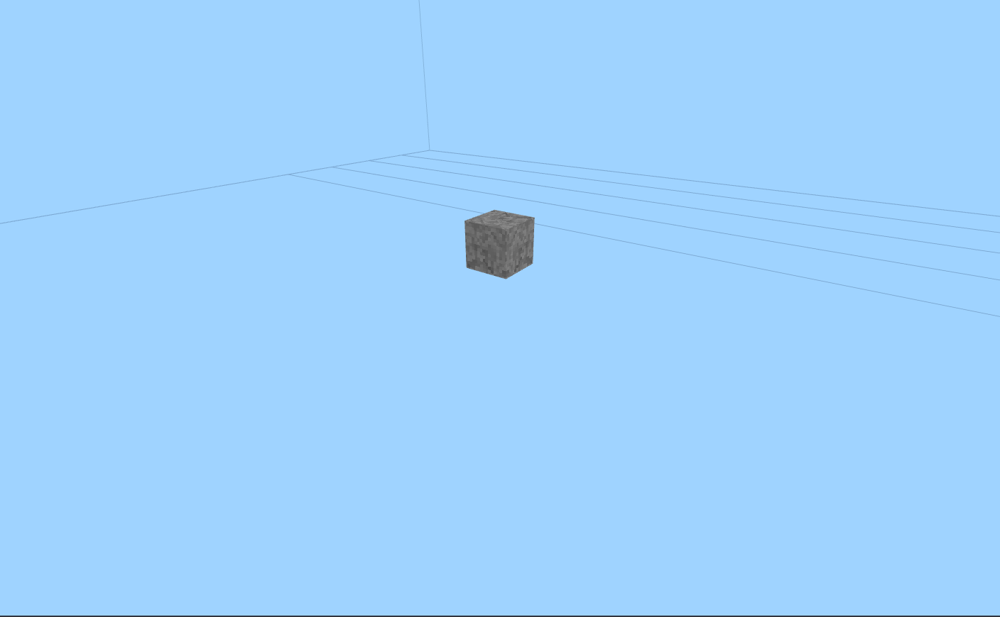
<!-- ws:scene {src: scenes/etape1.glb, camera: {from: [59.5, 13.5, 57.5], to: [64.5, 9, 64.5]}} -->

Vérifié automatiquement au clic sur « ▶ Générer » :

- Un bloc de pierre en (64, 10, 64)

Quand c'est réussi, la vérification passe au vert :


<!-- ws: {type: hint} -->
<details><summary>Indice 1</summary>

Les trois nombres sont toujours dans l'ordre x, y, z. La hauteur est le **deuxième**.

</details>

<!-- ws: {type: hint} -->
<details><summary>Indice 2</summary>

Une seule ligne suffit : `set_block(64, 10, 64, PIERRE)`

</details>

### Bonus

Construis une petite tour de 5 blocs de haut, puis pose un `DIAMANT` au sommet.

## Étape 2 : Le sol plat
<!-- ws: {type: exercise, id: sol-plat, points: 200, token_id: "2"} -->

<!-- ws:toolbox -->
### Boîte à outils

> 🧰 **La boucle `for`**
> Une **boucle** répète le code écrit entre `do` et `end`. Ici, `x` vaut 0, puis 1, puis 2… jusqu'à 9 : une ligne de 10 blocs.
>
> ```lua
> for x = 0, 9 do
>   set_block(x, 0, 0, PIERRE)
> end
> ```
>
> 
> <!-- ws:anim {src: img/outil-boucle.webm, chapters: img/outil-boucle.vtt} -->

> 🧰 **Une boucle dans une boucle**
> Pour chaque valeur de `x`, la boucle intérieure fait tous les `z`. 10 × 10 = un carré de 100 blocs.
>
> ```lua
> for x = 0, 9 do
>   for z = 0, 9 do
>     set_block(x, 0, z, PIERRE)
>   end
> end
> ```
>
> 
> <!-- ws:anim {src: img/outil-double-boucle.webm, chapters: img/outil-double-boucle.vtt} -->

> 🧰 **`TAILLE` « la largeur du monde »**
> `TAILLE` vaut 128, la largeur du monde. Les colonnes vont de `0` à `TAILLE - 1`, c'est-à-dire 127.
>
> ```lua
> print(TAILLE)
> print(TAILLE - 1)
> ```

> 🧰 **`print` « écrire dans la console »**
> `print` écrit dans la console, sous l'éditeur. C'est ta loupe : quand ton code ne fait pas ce que tu crois, affiche tes variables.
>
> ```lua
> for x = 0, 3 do
>   print("x vaut", x)
> end
> ```
<!-- /ws:toolbox -->

### Pièges

- `for x = 0, TAILLE do` fait **129** tours, pas 128 : le dernier bloc tombe hors du monde. La console te le signale.
- Chaque `for` a son `end`. Décale le code à l'intérieur vers la droite pour voir qui ferme quoi.

### Défi
<!-- ws:doit -->

Recouvre tout le sol du monde (y = 0) d'`HERBE` : les 128 × 128 colonnes.

Vérifié automatiquement au clic sur « ▶ Générer » :

- Les 16 384 colonnes ont un bloc à y = 0

Tu dois obtenir quelque chose comme ça :

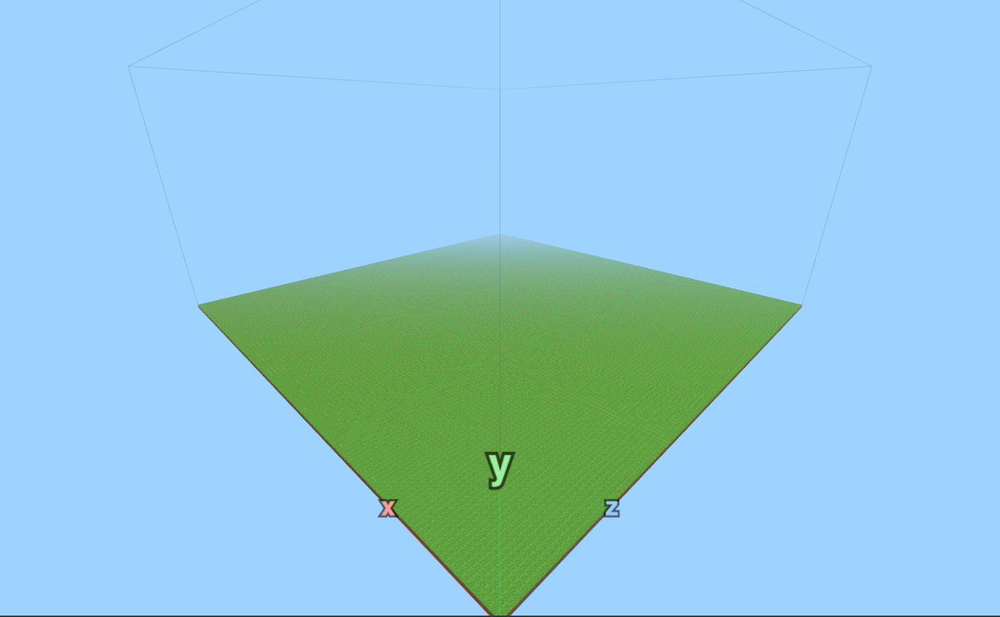
<!-- ws:scene {src: scenes/etape2.glb, camera: {from: [-22, 52, -22], to: [64, 0, 64]}} -->

<!-- ws: {type: hint} -->
<details><summary>Indice 1</summary>

Commence par une seule ligne de 128 blocs le long de x. Vole pour vérifier qu'elle touche les deux bords.

</details>

<!-- ws: {type: hint} -->
<details><summary>Indice 2</summary>

Mets ensuite cette boucle **à l'intérieur** d'une autre boucle, sur z.

</details>

<!-- ws: {type: hint} -->
<details><summary>Indice 3</summary>

```lua
for x = 0, TAILLE - 1 do
  for z = 0, TAILLE - 1 do
    ...
  end
end
```

</details>

### Bonus

Fais un damier : `HERBE` et `SABLE` en alternance. Indice : `(x + z) % 2` vaut 0 ou 1.

## Étape 3 : Une colonne
<!-- ws: {type: exercise, id: une-colonne, points: 150, validation: checkpoint} -->

<!-- ws:toolbox -->
### Boîte à outils

> 🧰 **Les variables**
> Une **variable** est une boîte avec un nom. Change la valeur de `SOL` une seule fois, et tout le code qui l'utilise suit.
>
> ```lua
> local SOL = 20
> set_block(64, SOL, 64, HERBE)
> set_block(64, SOL - 1, 64, TERRE)
> ```
>
> 
> <!-- ws:anim {src: img/outil-variables.webm, chapters: img/outil-variables.vtt} -->

> 🧰 **Une boucle vers le haut**
> La même boucle `for`, mais sur y : une colonne de pierre de y = 1 à y = 16.
>
> ```lua
> for y = 1, 16 do
>   set_block(64, y, 64, PIERRE)
> end
> ```
>
> 
> <!-- ws:anim {src: img/outil-colonne.webm, chapters: img/outil-colonne.vtt} -->

> 🧰 **Calculer avec les variables**
> On peut faire des calculs partout où on attend un nombre : `+`, `-`, `*` (fois), `/` (divisé).
>
> ```lua
> local SOL = 20
> print(SOL - 4, SOL - 3, SOL - 1)
> ```
<!-- /ws:toolbox -->

### Pièges

- Si la pierre va jusqu'à `SOL - 4`, la terre commence à `SOL - 3`. Un chiffre de travers et les couches se chevauchent.
- Si tu poses deux blocs au même endroit, c'est **le dernier** qui gagne.

### Défi
<!-- ws:doit -->

Construis **une seule colonne**, au centre du monde en (64, 64). De bas en haut : `BEDROCK` à y = 0, de la `PIERRE`, exactement 3 blocs de `TERRE`, puis l'`HERBE` au sommet, à la hauteur `SOL`.

L'application ne vérifie pas cette étape : c'est toi qui vérifies, avec cette liste.

- En volant autour, tu vois la bedrock, la pierre, 3 blocs de terre et l'herbe, dans cet ordre.
- Change `SOL` en 30, puis clique sur « ▶ Générer » : toute la colonne grandit d'un coup, couches comprises.

Tu dois obtenir quelque chose comme ça :

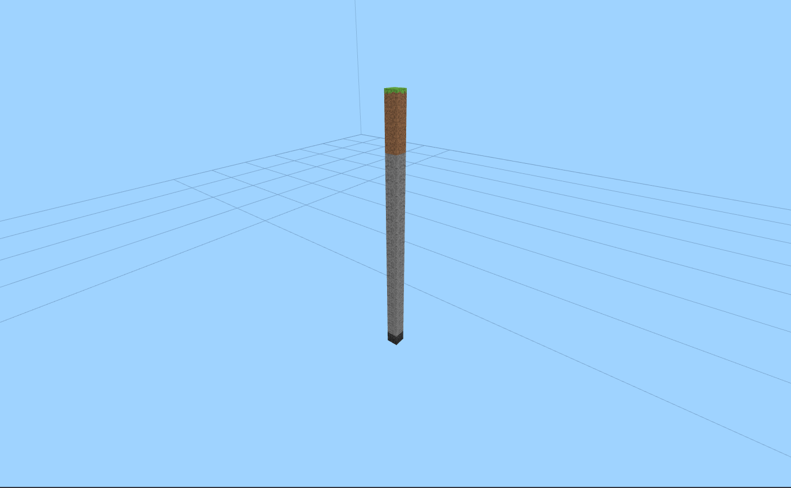
<!-- ws:scene {src: scenes/etape3.glb, camera: {from: [50, 23, 46], to: [64.5, 10, 64.5]}} -->

<!-- ws: {type: hint} -->
<details><summary>Indice 1</summary>

Avec `SOL = 20` : bedrock à 0, pierre de 1 à 16, terre de 17 à 19, herbe à 20.

</details>

<!-- ws: {type: hint} -->
<details><summary>Indice 2</summary>

Il te faut une boucle sur y pour la pierre, et une autre pour la terre.

</details>

<!-- ws: {type: hint} -->
<details><summary>Indice 3</summary>

Ta colonne ne grandit pas quand tu changes `SOL` ? Cherche les nombres écrits en dur : chaque hauteur doit se calculer à partir de `SOL`.

</details>

## Étape 4 : Le monde en colonnes
<!-- ws: {type: exercise, id: couches, points: 100, token_id: "3"} -->

<!-- ws:toolbox -->
### Boîte à outils

> 🧰 **Penser en colonnes**
> Ton monde, c'est 128 × 128 **colonnes**. Une colonne, c'est une pile de blocs posée en (x, z) : la bedrock tout en bas, puis la pierre, la terre, et l'herbe au sommet.
> Si tu sais construire **une** colonne, la double boucle de l'étape 2 construit toutes les autres.
>
> 
> <!-- ws:anim {src: img/outil-colonnes.webm, chapters: img/outil-colonnes.vtt} -->
<!-- /ws:toolbox -->

### Défi
<!-- ws:doit -->

Dans chaque colonne, de bas en haut : `BEDROCK` à y = 0, de la `PIERRE`, exactement 3 blocs de `TERRE`, puis l'`HERBE` au sommet.

Vérifié automatiquement au clic sur « ▶ Générer » :

- Bedrock, pierre, 3 terre, herbe

Pour vérifier encore : change `SOL` en 30, puis clique sur « ▶ Générer ». Tout ton monde doit monter d'un coup.

Tu dois obtenir quelque chose comme ça :

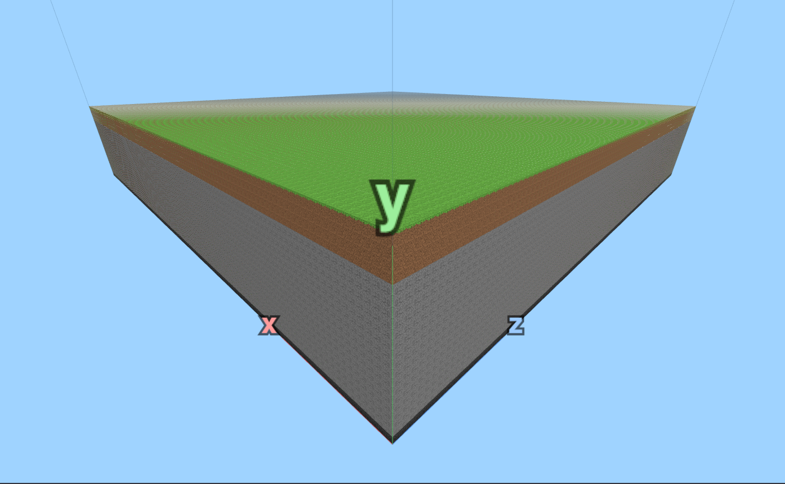
<!-- ws:scene {src: scenes/etape4.glb, features: [orbit, zoom, pan, reset, cut], cut: {axis: x}, camera: {from: [-14, 30, -14], to: [12, 12, 12]}} -->

<!-- ws: {type: hint} -->
<details><summary>Indice 1</summary>

Tu as déjà les deux boucles x et z de l'étape 2. C'est **à l'intérieur** que tu empiles la colonne.

</details>

<!-- ws: {type: hint} -->
<details><summary>Indice 2</summary>

Dans ta colonne de l'étape 3, x et z valaient 64. Dans la double boucle, ce sont les variables `x` et `z` qui prennent leur place.

</details>

### Bonus

Vole sous ton monde (<kbd>Maj</kbd>) et regarde la tranche : on voit les couches sur les bords.

## Étape 5 : La fonction colonne
<!-- ws: {type: exercise, id: colonne-fonction, points: 150, validation: checkpoint} -->
<!-- étape de modelage : la fonction colonne est donnée volontairement dans la boîte à outils -->

<!-- ws:toolbox -->
### Boîte à outils

> 🧰 **Écrire sa propre fonction avec `function`**
> Tu peux ranger du code sous un nom, puis le réutiliser. `x`, `z` et `h` sont les **paramètres** : des variables qui reçoivent les valeurs données à l'appel.
>
> ```lua
> function colonne(x, z, h)
>   set_block(x, 0, z, BEDROCK)
>   -- ... les couches, avec h comme hauteur de l'herbe
>   set_block(x, h, z, HERBE)
> end
>
> colonne(10, 10, 20)
> colonne(11, 10, 25)
> ```
>
> 
> <!-- ws:anim {src: img/outil-fonction.webm, chapters: img/outil-fonction.vtt} -->

> 🧰 **Une hauteur qui dépend de x**
> Ici, plus x est grand, plus le bloc est haut : une ligne d'herbe qui monte, un bloc plus haut tous les 10 blocs. Pas besoin d'arrondir : un bloc ne peut pas être à la hauteur 10,7, `set_block` arrondit vers le bas tout seul.
>
> ```lua
> for x = 0, TAILLE - 1 do
>   local h = 10 + x / 10
>   set_block(x, h, 0, HERBE)
> end
> ```
<!-- /ws:toolbox -->

### Pièges

- Une fonction doit être écrite **avant** la ligne qui l'appelle.
- Dans ta fonction, toutes les couches se calculent à partir de `h` : l'herbe en `h`, la terre juste en dessous. Si un nombre fixe comme `20` reste dans ta fonction, ce n'est plus `h` qui commande.

### Défi
<!-- ws:doit -->

Range la construction d'une colonne dans une fonction `colonne(x, z, h)`. Puis fais monter ton terrain en **pente douce** le long de x : chaque colonne aussi haute que sa voisine, ou un bloc plus haut, avec au moins **8 hauteurs différentes**. Les couches de l'étape 4 restent obligatoires.

L'application ne vérifie pas cette étape : c'est toi qui vérifies, en volant le long de ta pente.

- elle monte d'un bord du monde à l'autre, sans marche de plus d'un bloc ;
- sur la tranche, chaque colonne a toujours sa bedrock, sa pierre, ses 3 blocs de terre et son herbe.

Tu dois obtenir quelque chose comme ça :

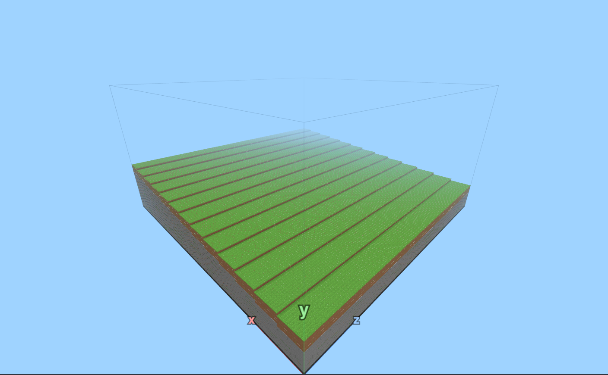
<!-- ws:scene {src: scenes/etape5.glb, camera: {from: [-30, 72, -30], to: [64, 12, 64]}} -->

<!-- ws: {type: hint} -->
<details><summary>Indice 1</summary>

Transforme le contenu de tes boucles en une fonction `colonne(x, z, h)`, où `SOL` devient `h`. Appelle-la avec la même hauteur partout : ton monde ne doit pas changer.

</details>

<!-- ws: {type: hint} -->
<details><summary>Indice 2</summary>

Dans la double boucle, calcule `h` pour chaque colonne à partir de x, puis appelle `colonne(x, z, h)`.

</details>

<!-- ws: {type: hint} -->
<details><summary>Indice 3</summary>

Ta pente monte trop vite ? **Divise** x par un plus grand nombre.

</details>

### Bonus

Fais monter la pente en diagonale : que `h` dépende de x **et** de z.

## Étape 6 : La vague
<!-- ws: {type: exercise, id: collines, points: 200, token_id: "4"} -->

<!-- ws:toolbox -->
### Boîte à outils

> 🧰 **`math.sin` « la vague »**
> `math.sin(t)` monte et descend entre -1 et 1, comme une vague. Trois nombres la règlent : le `20` dit à quelle hauteur elle flotte, le `5` sa **hauteur**, le `/ 8` sa **largeur**.
>
> ```lua
> for x = 0, TAILLE - 1 do
>   local h = 20 + 5 * math.sin(x / 8)
>   set_block(x, h, 0, HERBE)
> end
> ```

<!-- /ws:toolbox -->


<!-- ws:anim {src: img/etape6-vague.webm, chapters: img/etape6-vague.vtt} -->

### Pièges

- `math.sin(x)` tout seul ondule beaucoup trop vite : une vague tous les 6 blocs. Divise x pour élargir.
- Avec une vague trop haute, `h` peut dépasser 63 (le ciel) ou descendre sous 5 (plus de place pour les couches).

### Défi
<!-- ws:doit -->

Fais onduler ton terrain le long de x avec `math.sin` : au moins **8 hauteurs différentes**, et jamais une marche de plus de **2 blocs** entre deux colonnes voisines. Les couches de l'étape 4 restent obligatoires.

Vérifié automatiquement au clic sur « ▶ Générer » :

- Des collines douces avec les bonnes couches

Tu dois obtenir quelque chose comme ça :

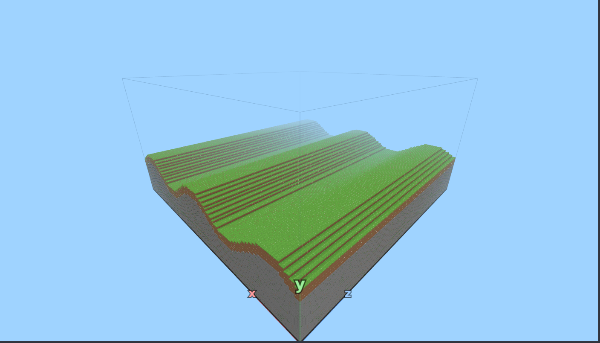
<!-- ws:scene {src: scenes/etape6.glb, camera: {from: [-30, 72, -30], to: [64, 12, 64]}} -->

<!-- ws: {type: hint} -->
<details><summary>Indice 1</summary>

Garde ta fonction `colonne` telle quelle : seule la ligne qui calcule `h` change.

</details>

<!-- ws: {type: hint} -->
<details><summary>Indice 2</summary>

Commence avec une petite hauteur de vague, par exemple `2 * math.sin(x / 8)`, génère, puis augmente-la.

</details>

<!-- ws: {type: hint} -->
<details><summary>Indice 3</summary>

Si la vérification parle d'une marche trop haute, **divise** x par un plus grand nombre.

</details>

## Étape 7 : Les collines
<!-- ws: {type: exercise, id: collines-deux-sens, points: 150, validation: checkpoint} -->
<!-- étape de modelage : la formule à deux vagues est donnée volontairement dans la boîte à outils -->

<!-- ws:toolbox -->
### Boîte à outils

> 🧰 **Une vague en x, une vague en z**
> Avec `math.sin(x / 8)` seul, toutes les colonnes qui ont le même x ont la même hauteur, quel que soit z : rien ne change quand tu avances vers le fond. Pour que ça bouge aussi dans ce sens, ajoute une deuxième vague qui, elle, regarde z. Les deux s'additionnent : la tôle ondulée devient une **boîte d'œufs**.
>
> ```lua
> local h = 20 + 4 * math.sin(x / 8) + 4 * math.sin(z / 11)
> ```

> 🧰 **Pourquoi 8 et 11 ?**
> Deux largeurs différentes, pour que les bosses ne tombent pas toutes au même endroit. Essaie `8` et `8`, puis `8` et `11`, et regarde la différence depuis le ciel.
<!-- /ws:toolbox -->

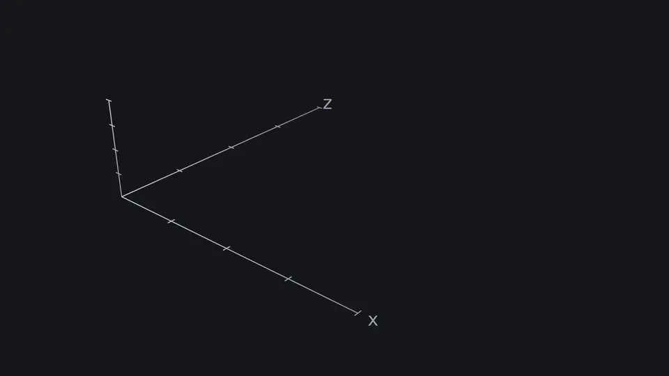
<!-- ws:anim {src: img/etape7-collines.webm, chapters: img/etape7-collines.vtt} -->

### Pièges

- Deux vagues de hauteur 4 font une hauteur totale de 8 : vérifie que `h` reste entre 5 et 63.
- Si tu écris `math.sin(x / 8 + z / 11)`, c'est **une seule** vague, en diagonale. Il faut deux `math.sin`.

### Défi
<!-- ws:doit -->

Ajoute une deuxième vague qui dépend de z. Ton terrain doit onduler **dans les deux sens** : le long de x, et aussi quand tu voles vers le fond.

L'application vérifie encore la douceur du terrain, pas le deuxième sens : c'est toi qui vérifies, en volant.

- vole vers le fond du monde : ça monte et ça descend ;
- vu du ciel, des bosses et des creux partout, comme une boîte d'œufs.

Tu dois obtenir quelque chose comme ça :


<!-- ws:scene {src: scenes/etape7.glb, camera: {from: [-30, 72, -30], to: [64, 12, 64]}} -->

<!-- ws: {type: hint} -->
<details><summary>Indice 1</summary>

Ta ligne `h` a déjà une vague qui dépend de x. Ajoute `+ 4 * math.sin(z / 11)` juste après.

</details>

<!-- ws: {type: hint} -->
<details><summary>Indice 2</summary>

Si le terrain fait des marches trop hautes, baisse les deux `4`, ou augmente les deux largeurs.

</details>

### Bonus

Multiplie les deux vagues au lieu de les additionner. Que se passe-t-il ?

## Étape 8 : Le vrai relief
<!-- ws: {type: exercise, id: relief, points: 250, token_id: "5"} -->

<!-- ws:toolbox -->
### Boîte à outils

> 🧰 **`perlin2d(x, z)` « un hasard tout doux »**
> `perlin2d` renvoie un nombre entre -1 et 1. Si x et z bougent *un peu*, le résultat bouge *un peu* : c'est ce qui rend les collines douces.
>
> ```lua
> print(perlin2d(10.5, 3.2))
> print(perlin2d(10.6, 3.2))
> print(perlin2d(50.1, 80.7))
> ```

> 🧰 **L'échelle**
> Le `/ 40` règle la **largeur** des collines, le `* 12` leur **hauteur**.
>
> ```lua
> local h = 24 + math.floor(perlin2d(x / 40, z / 40) * 12)
> ```

> 🧰 **Les octaves**
> Un seul bruit donne des collines lisses. On en **additionne** plusieurs : un grand pour les montagnes, un moyen pour les bosses, un petit pour les détails. Chaque couche s'appelle une **octave**.
>
> ```lua
> local n = perlin2d(x / 60, z / 60) * 24
>         + perlin2d(x / 24, z / 24) * 6
>         + perlin2d(x / 8, z / 8) * 1.5
> local h = math.floor(26 + n)
> ```
>
> 
> <!-- ws:anim {src: img/outil-octaves.webm, chapters: img/outil-octaves.vtt} -->

> 🧰 **La seed**
> La **seed** (la graine, en haut du monde) choisit un bruit parmi des milliards. Même code et même seed : exactement le même monde. Change-la pour en découvrir un autre.
<!-- /ws:toolbox -->


<!-- ws:anim {src: img/etape8-perlin.webm, chapters: img/etape8-perlin.vtt} -->

### Pièges

- `perlin2d` avec des nombres **entiers** renvoie toujours 0 : `perlin2d(3, 7)` vaut 0. Divise toujours x et z.
- Plus tu divises x et z, plus les collines sont **larges**. Plus tu multiplies le résultat, plus elles sont **hautes**.

### Défi
<!-- ws:doit -->

Remplace `math.sin` par `perlin2d` : un relief naturel d'au moins **15 blocs de dénivelé** entre le point le plus bas et le plus haut, sans falaise de plus de 3 blocs. Les couches restent obligatoires.

Vérifié automatiquement au clic sur « ▶ Générer » :

- Un relief naturel fait avec perlin2d

Tu dois obtenir quelque chose comme ça :

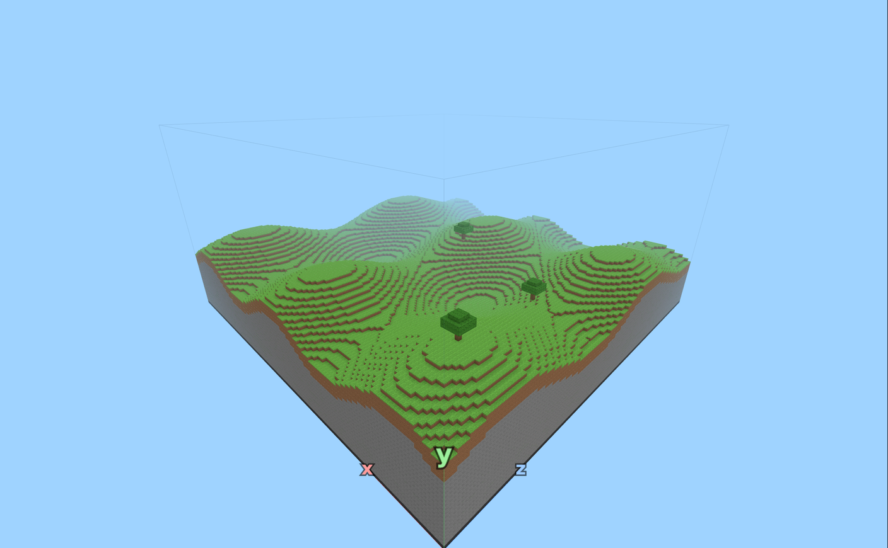
<!-- ws:scene {src: scenes/etape8.glb, features: [orbit, zoom, pan, reset, cut], cut: {axis: x}, camera: {from: [-30, 72, -30], to: [64, 12, 64]}} -->

<!-- ws: {type: hint} -->
<details><summary>Indice 1</summary>

Écris une fonction `hauteur(x, z)` qui renvoie (`return`) la hauteur de la colonne.

</details>

<!-- ws: {type: hint} -->
<details><summary>Indice 2</summary>

Si ton terrain est plat, affiche `perlin2d(x, z)` : as-tu oublié de diviser ?

</details>

<!-- ws: {type: hint} -->
<details><summary>Indice 3</summary>

Pas assez de dénivelé ? Multiplie davantage le grand bruit.

</details>

### Bonus

Mets `math.abs(perlin2d(...))` pour le grand bruit : tu obtiens des crêtes de montagne.

## Étape 9 : Mers, plages et neige
<!-- ws: {type: exercise, id: mers-plages-neige, points: 250, token_id: "6"} -->

<!-- ws:toolbox -->
### Boîte à outils

> 🧰 **`if` « faire un choix »**
> `if` exécute du code seulement si une condition est vraie. `elseif` teste une autre condition, `else` s'occupe de tous les autres cas.
>
> ```lua
> local h = 30
> if h < 20 then
>   print("bas")
> elseif h > 35 then
>   print("haut")
> else
>   print("au milieu")
> end
> ```
>
> 
> <!-- ws:anim {src: img/outil-if.webm, chapters: img/outil-if.vtt} -->

> 🧰 **Choisir le bloc du dessus**
> On range le type de bloc dans une variable, et on la change si besoin avant de poser.
>
> ```lua
> local dessus = HERBE
> if h >= 34 then
>   dessus = NEIGE
> end
> set_block(x, h, z, dessus)
> ```
>
> 
> <!-- ws:anim {src: img/outil-dessus.webm, chapters: img/outil-dessus.vtt} -->

> 🧰 **Remplir d'eau**
> De l'eau de `h + 1` jusqu'au niveau de la mer. Si le sol est plus haut que la mer, la boucle ne fait **aucun tour** : pas d'eau. Pratique !
>
> ```lua
> NIVEAU_MER = 22
> for y = h + 1, NIVEAU_MER do
>   set_block(x, y, z, EAU)
> end
> ```
>
> 
> <!-- ws:anim {src: img/outil-eau.webm, chapters: img/outil-eau.vtt} -->

> 🧰 **Les comparaisons**
> `<` plus petit, `>` plus grand, `<=` et `>=` « ou égal », `==` égal, `~=` différent.
<!-- /ws:toolbox -->

### Pièges

- `=` range une valeur, `==` compare. On écrit `if h == 20 then`.
- L'eau se pose **au-dessus** du sol, jamais à sa place.
- Si `NIVEAU_MER` est plus bas que tout ton terrain, il n'y aura pas de mer du tout.

### Défi
<!-- ws:doit -->

Ajoute une **mer** à hauteur fixe, du `SABLE` partout où la terre touche l'eau, et de la `NEIGE` au sommet des montagnes.

Vérifié automatiquement au clic sur « ▶ Générer » :

- Une mer, des plages et de la neige

Tu dois obtenir quelque chose comme ça :

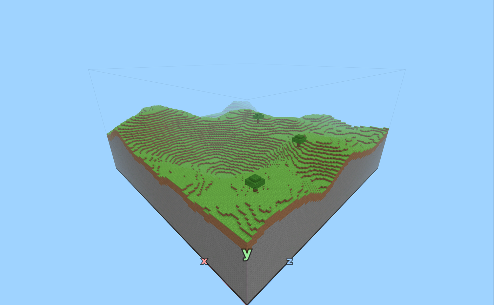
<!-- ws:scene {src: scenes/etape9.glb, features: [orbit, zoom, pan, reset, cut], cut: {axis: z}, camera: {from: [-30, 72, -30], to: [64, 12, 64]}} -->

<!-- ws: {type: hint} -->
<details><summary>Indice 1</summary>

Choisis `NIVEAU_MER` pour qu'une partie de ton terrain soit dessous. Affiche quelques hauteurs pour t'aider.

</details>

<!-- ws: {type: hint} -->
<details><summary>Indice 2</summary>

Une plage, c'est une colonne à peine plus haute que la mer : `h <= NIVEAU_MER + 1`.

</details>

<!-- ws: {type: hint} -->
<details><summary>Indice 3</summary>

Sous l'eau, mets aussi du sable à la place de l'herbe et de la terre.

</details>

### Bonus

Pose de la `GLACE` à la surface de l'eau quand la mer est entourée de neige.

## Étape 10 : Forêts, grottes et minerais
<!-- ws: {type: exercise, id: forets-grottes-minerais, points: 350, token_id: "7"} -->

<!-- ws:toolbox -->
### Boîte à outils

> 🧰 **`random(a, b)` « lancer un dé »**
> `random(1, 6)` donne un nombre entier entre 1 et 6, comme un dé. Il dépend de la seed : même seed, mêmes tirages, donc même monde.
>
> ```lua
> print(random(1, 6), random(1, 6), random(0, TAILLE - 1))
> ```

> 🧰 **`get_block` et `while` « trouver le sol »**
> `get_block(x, y, z)` dit quel bloc se trouve à un endroit. `while` répète *tant que* la condition est vraie : on descend depuis le ciel jusqu'au premier bloc.
>
> ```lua
> local x, z = 64, 64
> local y = HAUTEUR - 1
> while y > 0 and get_block(x, y, z) == AIR do
>   y = y - 1
> end
> print("le sol est à y =", y)
> ```
>
> 
> <!-- ws:anim {src: img/outil-sol.webm, chapters: img/outil-sol.vtt} -->

> 🧰 **Une fonction arbre**
> Un tronc de 5 blocs, puis des feuilles autour du haut. À toi de compléter la couronne.
>
> ```lua
> function arbre(x, y, z)
>   for i = 0, 4 do
>     set_block(x, y + i, z, BOIS)
>   end
>   set_block(x, y + 5, z, FEUILLES)
> end
> ```
>
> 
> <!-- ws:anim {src: img/outil-arbre.webm, chapters: img/outil-arbre.vtt} -->

> 🧰 **`perlin3d` « creuser des grottes »**
> Même idée que `perlin2d`, mais en 3D. Là où il dépasse un seuil, on **ne pose pas** de pierre : ça fait un trou. Plus le seuil est bas, plus les grottes sont grandes.
>
> ```lua
> if perlin3d(x / 16, y / 10, z / 16) > 0.3 then
>   -- grotte : on ne pose rien
> else
>   set_block(x, y, z, PIERRE)
> end
> ```
>
> 
> <!-- ws:anim {src: img/outil-grottes.webm, chapters: img/outil-grottes.vtt} -->

> 🧰 **`return` « une fonction qui répond »**
> Une fonction peut **renvoyer** une valeur. Ici, elle choisit quel bloc poser.
>
> ```lua
> function pierre(y)
>   if y < 12 and random(1, 200) == 1 then
>     return DIAMANT
>   end
>   return PIERRE
> end
>
> print(pierre(5))
> ```
<!-- /ws:toolbox -->

### Pièges

- Une boucle `while` dont la condition reste toujours vraie ne s'arrête jamais : ton code est coupé au bout de 5 secondes.
- Si une grotte touche la surface, elle fait un trou dans le sol, et l'eau se retrouve à flotter au-dessus.
- Les arbres poussent sur l'herbe : pas dans l'eau, ni sur le sable, ni dans le vide.

### Défi
<!-- ws:doit -->

Trois défis : au moins **10 arbres** plantés sur l'herbe, des **grottes** creusées avec `perlin3d`, et des **minerais** : du `CHARBON`, et du `DIAMANT` seulement tout au fond (y < 12).

Vérifié automatiquement au clic sur « ▶ Générer » :

- Au moins 10 arbres
- Des grottes creusées avec perlin3d
- Charbon, et diamants tout au fond

Tu dois obtenir quelque chose comme ça :

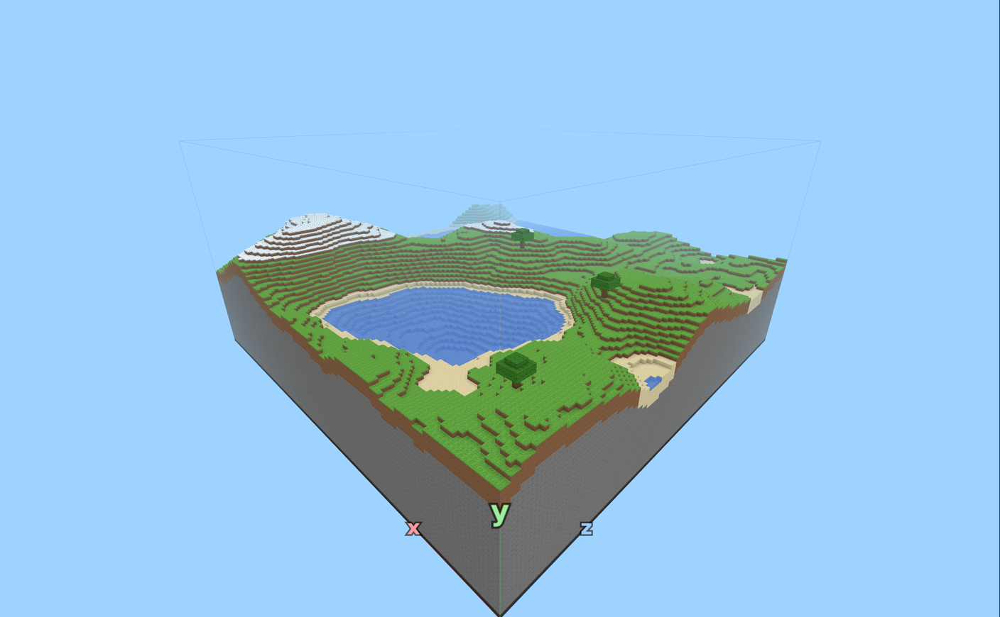
<!-- ws:scene {src: scenes/etape10.glb, features: [orbit, zoom, pan, reset, cut], cut: {axis: x}, camera: {from: [-18, 58, -18], to: [50, 20, 50]}} -->

Et sous tes pieds :

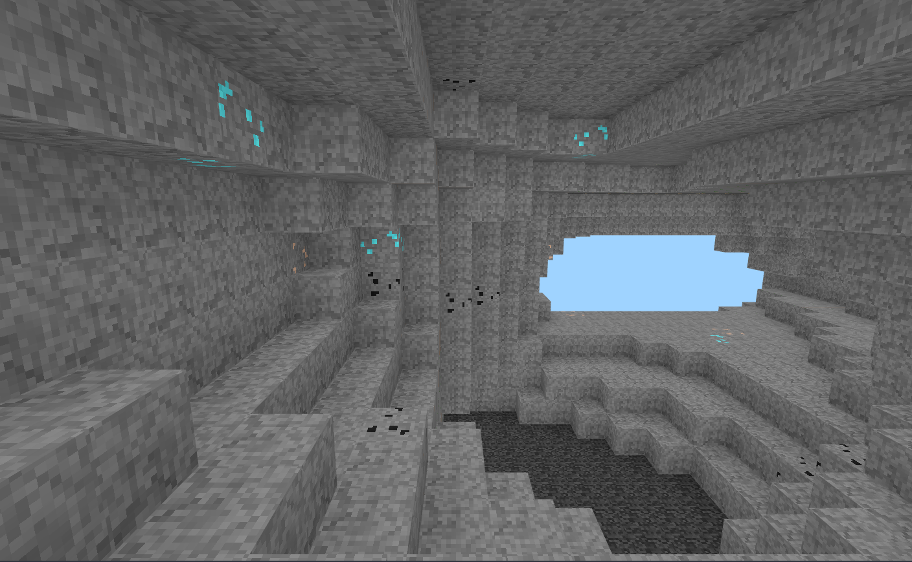

<!-- ws: {type: hint} -->
<details><summary>Indice 1</summary>

Pour planter un arbre : tire x et z au hasard, cherche le sol avec `while`, et plante seulement si `get_block(x, y, z) == HERBE`.

</details>

<!-- ws: {type: hint} -->
<details><summary>Indice 2</summary>

Plante les arbres **après** la double boucle du terrain, sinon il n'y a pas encore de sol.

</details>

<!-- ws: {type: hint} -->
<details><summary>Indice 3</summary>

Pour les grottes, ne creuse pas trop près de la surface : par exemple seulement si `y < h - 5`.

</details>

<!-- ws: {type: hint} -->
<details><summary>Indice 4</summary>

Pour les minerais, remplace `PIERRE` par l'appel d'une fonction qui renvoie parfois un minerai.

</details>

### Bonus

**Défi libre** : invente des biomes. Un deuxième bruit très large peut décider d'une zone de désert (sable, pas d'arbres) ou d'une forêt dense. Puis partage ta seed préférée !

## Et maintenant

Tu es parti d'un bloc. Ton code dessine maintenant un monde entier, avec ses montagnes, ses mers, ses forêts et ses grottes, et il tient en quelques dizaines de lignes. C'est exactement comme ça que Minecraft fabrique les siens.

Change la seed, promène-toi, et garde ton code : la prochaine idée est la tienne.
